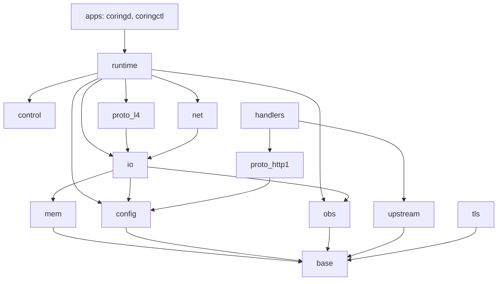
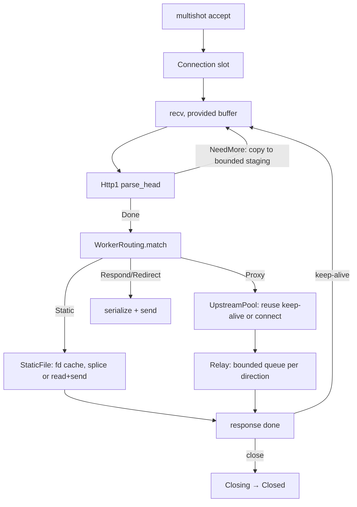

# Architecture

## 1. Goals and non-goals

Goals: a correct, observable, hot-reloadable proxy for HTTP/1.1, HTTP/2,
HTTP/3, and raw TCP/UDP, built on `io_uring`, one pinned thread per core, no
shared mutable state between workers on the data path.

Non-goals: Windows/macOS; kernels older than 6.1; a plugin/scripting system;
caching/WAF/rate-limit zones (revisit after Tier 2); writing our own TLS, HPACK
or QUIC; multi-process clustering (one process + systemd restart is enough).

## 2. Layering

One static library per module (`coring5_<module>`). Links go **downward only**.
`tools/check_layering.py` verifies the `#include` graph matches (CI job
`layering`); CMake verifies the link graph. An illegal dependency fails one of
the two.



| Module | Responsibility | Depends on kernel `io_uring`? |
|---|---|---|
| `base` | `Result`/`Error`, `Handle`, `Endpoint`, `ReloadAck`, time types | no |
| `mem` | `HandlePool` (generation handles), `Region` (mmap slab) | no |
| `config` | Snapshot types, TOML loader, validator, diff | **no** (testable anywhere) |
| `obs` | Per-worker metric shards, histograms, SPSC ring, access-log record | no |
| `io` | `Ring`, `BufferRing`, `OpTag`, `TimerWheel`, `Connection`, `IoContext` | yes |
| `net` | Listening-socket creation (control thread) | no (plain sockets) |
| `proto/http1` | Sans-IO request-head parser (body framing: M4) | no |
| `proto/l4` | `EchoConnection` (reference); TCP/UDP relay (M3/M9) | via `io` |
| `upstream`, `tls`, `handlers` | Design stubs for M3/M4/M5 | – |
| `control` | Unix-socket admin server | no |
| `runtime` | `Worker`, `WorkerGroup`, `Mailbox`, `ConfigManager`, `Daemon` | via `io` |

`config` and `proto/http1` deliberately do not depend on `io`: parsing and
validation are pure data transforms and are unit-tested/fuzzed without a ring.

## 3. Threads

```
main/control thread                      N worker threads (pinned, 1 ring each)
────────────────────                     ─────────────────────────────────────────
signalfd (SIGHUP/TERM/INT)               Ring (SINGLE_ISSUER, DEFER_TASKRUN if available)
ControlServer thread                     BufferRing (provided buffers, one slab)
ConfigManager: parse, validate,          HandlePool<Connection>, HandlePool<ListenerSlot>
  bind sockets, build snapshot           TimerWheel (intrusive nodes)
                                         shared_ptr<const ConfigSnapshot>
        │  Mailbox (mutex+vector+eventfd)  ▲   ReloadAck (atomic counter)
        └──────────────────────────────────┘   WorkerMetrics shard (single writer)
```

* **Workers share nothing mutable.** Cross-thread edges: the mailbox
  (control→worker, cold), `ReloadAck` (worker→control), and metric shards
  (single writer per shard, relaxed atomics, read by the control thread).
* **All fallible work happens on the control thread** (invariant I5): parsing,
  validation, DNS (future), certificate loading (future), `socket/bind/listen`.
  A worker's `ApplyConfig` handler cannot fail halfway.
* **Startup is two-phase.** `WorkerGroup::start()` creates each `Worker` *on its
  own thread* (invariant I1), waits for every `init()` result, and only then
  releases all workers to run. If any worker fails (pin, ring, buffer ring) all
  threads are joined and the first error is returned.
* **Signals** are blocked in every worker thread and handled by the main thread
  through `signalfd`.
* A helper thread for slow work (TLS handshakes, cold `open/stat`) is *not*
  added speculatively. Add it only when the loop-stall histogram
  (`coring_loop_ns_p999_upper_bound_max`) says it is needed, and document the
  exception.

## 4. The worker loop

```
init():  pin(cpu) → Ring::create → BufferRing::create → TimerWheel → pools
         → arm mailbox poll (multishot) + tick (timeout)
run():   loop:
           submit_and_wait(1)
           ctx.now = now()
           reap CQEs → dispatch (by OpTag kind)
           timers.advance(now) → Connection::handle_timer
           retry tick/mailbox arming if the SQ had been full
           reap_closed()          // destroy Closed connections at a safe point
           buffers.publish()      // one tail store per iteration
           shutdown progress check
           metrics: loop_iterations, buffers_free, sq_full, cq_overflow, loop_ns
```

Dispatch is one switch on `OpTag::kind()`; connection CQEs then do one lookup
`HandlePool::get(handle)` and one virtual call `Connection::handle_cqe`. A
failed lookup increments `stale_events`, which must stay at 0 (see INVARIANTS.md).

### Completion tag (`io/OpTag.hpp`)

```
63            32 31          12 11      6 5       0
+---------------+--------------+---------+--------+
|      gen      |    index     |  kind   |  aux   |   explicit shifts, not bit-fields
+---------------+--------------+---------+--------+   (bit-field layout is implementation-defined)
```

Capacity is therefore ≤ 2^20 slots per pool. `aux` distinguishes e.g. a
connection's own cancel (`kAuxConnection`) from a listener removal cancel
(`kAuxWorker`).

### Connection lifecycle (`io/Connection.hpp`)

```mermaid
stateDiagram-v2
  [*] --> Active
  Active --> Draining: begin_drain (reload / shutdown)
  Active --> Closing: close(reason)
  Draining --> Closing: close(reason)
  Closing --> Closed: inflight == 0 → fd closed
  Closed --> [*]: Worker::reap_closed() destroys the slot
```

Derived classes (`EchoConnection`, future HTTP/L4 sessions) implement `start`,
`on_cqe`, `on_timer`, `on_drain` and wrap *every* ring submission in
`counted(...)`. The base class owns the fd, the timer node, the in-flight
counter and the close sequence (cancel → wait → close). Details and rationale
in INVARIANTS.md (I2, I3).

## 5. Memory

* **No allocation on the data path** (I7). `HandlePool` has fixed capacity and
  returns `{invalid, nullptr}` when full; the worker counts
  `conns_rejected` and closes the accepted fd (load shedding).
* **Provided buffers.** One `mmap` slab (`Region`, pre-faulted on the worker
  thread so pages are first-touched on its NUMA node, `MADV_HUGEPAGE` best
  effort). `buffer id → address` is `base + bid * buf_size`. `recycle()` passes
  the real buffer size as the length (the Coring4 pool passed the buffer *count*).
* **Leases.** `BufferRing::Lease` is a move-only RAII handle that recycles on
  destruction; `publish()` makes recycled buffers visible once per loop
  iteration. Never hold a lease across an idle period (I10).
* **Connection slots** are fixed-size (`kConnectionSlotBytes = 512`); a derived
  class that does not fit fails a `static_assert`.
* **Timers** are intrusive (`TimerNode` embedded in the connection): scheduling
  never allocates and a destroyed connection can't leave a stale timer behind.

## 6. Error model

* `Result<T> = std::expected<T, Error>` with `Error{Errc code; int sys;}` (8
  bytes, trivially copyable) on the data path. No exceptions on workers.
* Cold paths (config, startup) return human-readable `std::string` errors.
* Classes: programmer error → `assert`; per-connection error → close with a
  labelled reason (`closes{reason=...}` metric); per-worker exhaustion → shed
  load; unrecoverable ring failure → `std::terminate()` so the supervisor
  restarts the process (the only remaining `terminate` in `Worker::run`).

## 7. Planned data path (HTTP/1.1 reverse proxy, M4)



### Backpressure (I6)

Each byte stream `src → dst` goes through one bounded queue with high/low
watermarks (`limits.queue_high_watermark` / `queue_low_watermark`, replacing
the three conflicting constants in Coring4). Rules the relay must follow:

* Pausing a multishot recv is asynchronous; data may still arrive after the
  decision to pause and must be accepted, not dropped. (Single-shot recv per
  direction in streaming phases gives natural backpressure.)
* `-ENOBUFS` on a recv means "buffer ring empty": treat as "retry later /
  shed", not as a protocol error.
* Half-close: EOF on one side ⇒ flush the queue, `shutdown(SHUT_WR)` on the
  other; close when both directions are done.
* Short sends are normal; `EchoConnection` shows the loop.
* Zero-copy: `SEND_ZC` yields two CQEs (result with `F_MORE`, then `F_NOTIF`);
  the buffer and the connection must stay alive until the second. Make the
  threshold configurable and benchmark it (loopback falls back to copying).
  `io_uring` has no `sendfile` opcode: static files use `splice(file→pipe→socket)`
  or `read`+`send`; kTLS allows real `sendfile` from a helper.

## 8. Protocols

Parsers and framers are **sans-IO**: bytes in, events out, no sockets.

* **HTTP/1.1** (`proto/http1`): implemented head parser is strict by policy —
  it *rejects* (never normalizes) bare LF, NUL/control characters, obs-fold,
  whitespace before `:`, CL+TE together, duplicate/conflicting
  `Content-Length`, `Transfer-Encoding` other than exactly `chunked`, and
  head/URI/header-count over limits. Strings in `RequestHead` point into the
  caller's buffer. Body framing and the response side are M4.
* **HTTP/2** (M8): nghttp2 adapter; stream flow control mapped to the relay
  watermarks; limits for rapid-reset, CONTINUATION floods, HPACK size.
* **HTTP/3** (M10): ngtcp2 + nghttp3, UDP GSO/GRO, multishot `recvmsg`; encode
  the worker id in the connection ID and steer with a reuseport eBPF program,
  because QUIC connections migrate between 4-tuples.
* **TLS** (M5): OpenSSL with memory BIOs; the library never touches the socket.
  `SSL_CTX` objects are built on the control thread and shared read-only.
* **L4** (M3/M9): see `proto/l4/TcpRelay.hpp` for the design notes.

## 9. Observability

`WorkerMetrics` (cache-line aligned, single writer): `accepts`,
`accept_errors`, `conns_rejected`, `conns_live`, **`stale_events`**, `nobufs`,
`sq_full`, `cq_overflow`, `bytes_in/out`, `loop_iterations`, `cqes`,
`buffers_free`, `config_generation`, `closes[reason]`, and a log2 histogram
`loop_ns`. `coringctl stats` renders Prometheus-style text aggregated over
shards. The log2 histogram is for spotting loop stalls only; measure request
latency with HDR histograms on the load generator (BENCHMARKING.md).

## 10. Security posture

* Control socket: mode 0660 (created under `umask 0117`), `SO_PEERCRED` check
  (same uid as the daemon or root), 1 s receive timeout.
* Parser strictness as above; hard limits on head size, header count, URI.
* systemd unit drops privileges, keeps only `CAP_NET_BIND_SERVICE`.
* Planned (M7): per-IP connection limits, slowloris/header-bomb timeouts
  (`header_timeout_ms`), access-log ring.
