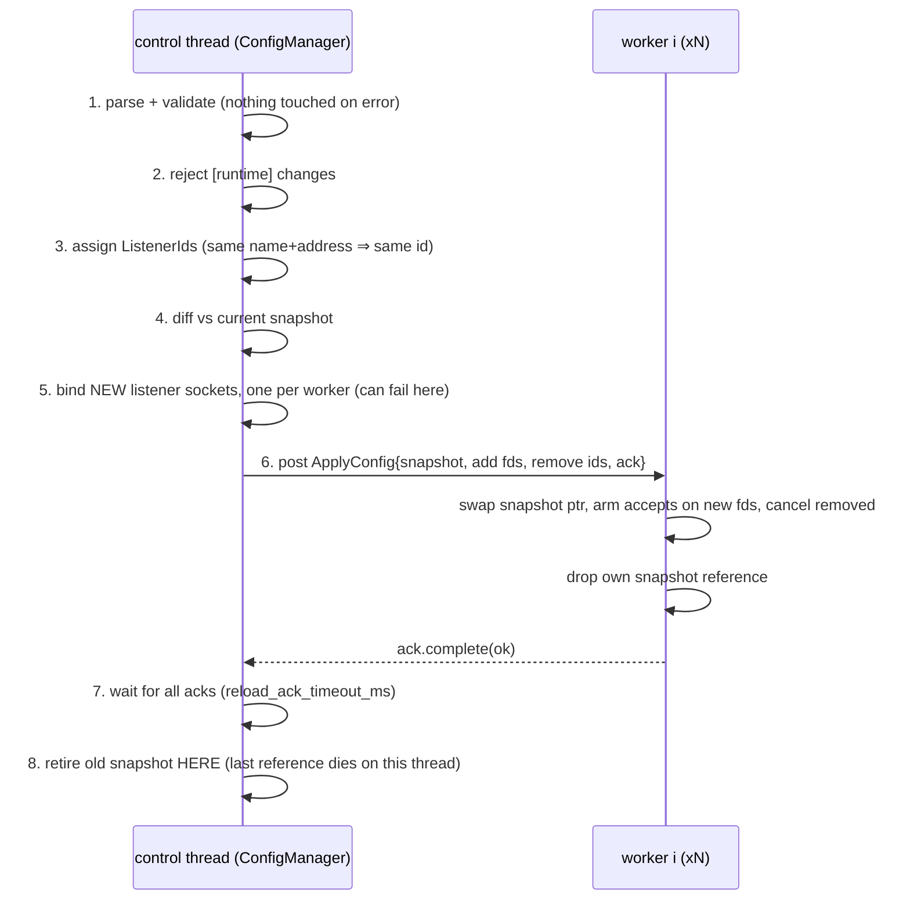

# Configuration and hot reload

## 1. File format (TOML)

Parsed only on the control thread (`config/Loader.cpp`, toml++). A worker never
sees text. See `deploy/coring.example.toml` for a complete example.

```toml
[runtime]                    # fixed for the process lifetime
workers = 2                  # 1..1024
cpus = [2, 3]                # optional; >= one cpu per worker
max_connections_per_worker = 10000   # 1..2^20
buffer_count = 1024          # power of two, 2..32768
buffer_size = 16384          # 512..1 MiB
ring_sq_entries = 2048       # powers of two, cq >= sq
ring_cq_entries = 8192
tick_ms = 50                 # 1..1000, timer-wheel resolution
drain_timeout_ms = 10000
reload_ack_timeout_ms = 5000

[limits]                     # hot-reloadable
idle_timeout_ms = 60000
header_timeout_ms = 10000
connect_timeout_ms = 3000
keepalive_timeout_ms = 60000
max_head_bytes = 16384
max_headers = 100
max_uri_bytes = 8192
queue_high_watermark = 262144
queue_low_watermark = 65536  # must be < high

[[listener]]                 # hot-reloadable
name = "echo"                # unique
address = "127.0.0.1:8080"   # "ip:port", "[v6]:port", ":port"; numeric hosts only
protocol = "echo"            # only "echo" is accepted today
# route / upstream / tls     # names resolved against future catalogues (M3-M5)
```

Validation (`validate_config`) is separate from parsing (`parse_config`):
syntax/type errors come from the parser; duplicate names/addresses, power-of-two
sizes, watermark ordering, timeouts shorter than the tick, and unimplemented
protocols come from the validator. All errors are human-readable strings naming
the section and key. The `config` fuzz target exercises both.

Numeric hosts only: DNS must be resolved on the control thread before an
`Endpoint` is built (future work for upstreams); the data path never calls
`getaddrinfo`.

## 2. What reloads and what does not

| Section | Hot reload | Notes |
|---|---|---|
| `[limits]` | yes | Takes effect for new timers/requests; running timers keep their deadline |
| `[[listener]]` add | yes | New `SO_REUSEPORT` sockets, one per worker, bound on the control thread |
| `[[listener]]` remove | yes | Stop accepting, cancel the multishot accept, close the socket; existing connections continue until they finish |
| `[[listener]]` change of `name` **or** `address` | yes | Treated as remove + add (a new `ListenerId`) |
| `[runtime]` | **no** | A reload whose `[runtime]` differs is **rejected** with "restart required"; the old config keeps running |

## 3. The reload protocol

Triggers: `SIGHUP` to `coringd`, or `coringctl reload`. Both call
`Daemon::reload()` → `ConfigManager::apply()` (serialised by a mutex).



### Guarantees (and the tests that check them)

| Guarantee | Test |
|---|---|
| A broken config (syntax, duplicate name, bad address, `[runtime]` change) is rejected as a whole; generation does not advance; old config keeps serving | `Reload.BadConfigIsRejectedAndOldOneKeepsServing` |
| A listener that cannot be bound fails the reload on the control thread **before any worker is touched** | `Reload.UnbindableListenerFailsBeforeAnyWorkerIsTouched` |
| Add/remove of listeners without restart; removed listener stops accepting | `Reload.AddsAndRemovesListenersWithoutRestart` |
| **Reloading under load does not fail requests on kept listeners** (25 reloads while 4 threads loop connect/echo/close; 0 failures) | `Reload.UnderLoadDoesNotFailRequestsOnKeptListeners` |
| `stale_events` stays 0 across all of the above | all reload tests |

### Failure semantics you should know

* **Eventual consistency across workers.** Workers apply the snapshot as each
  one reaches its mailbox event; for a short window worker A may serve the new
  config while worker B still serves the old one. `reload` returns `acked=true`
  once every worker has applied it.
* **Ack timeout.** If a worker does not ack within `reload_ack_timeout_ms`
  (a stalled loop), `apply()` still publishes the new snapshot on the control
  side and reports `acked=false`; the stalled worker converges when it next
  runs. The old snapshot is retired on the control thread regardless; workers
  hold their own `shared_ptr`, so this is memory-safe.
* **Partial worker failure.** The only worker-side failure is the per-worker
  listener-pool limit (1024). It is reported via `ReloadAck::failures()` and the
  reload returns an error even though other workers applied the change. Treat
  as a bug/limit breach; the status line shows the running generation.
* **Port 0.** For `address = ":0"` worker 0's socket is bound first and its
  resolved port is reused for the other workers, so all share one ephemeral
  port.
* **Listener identity.** `ListenerId` is stable while `name` *and* `address`
  stay the same, so unchanged listeners keep their sockets and are never
  closed/reopened by a reload (no accept-queue loss — the `SO_REUSEPORT`
  hazard where closing a group member drops its queue is avoided by not
  touching kept listeners).
* **Shutdown during reload** is serialised through the same mutex.

## 4. Control protocol

`coringctl [--socket PATH] ping|reload|stats|status|shutdown`; one line in, one
response out; `ERR ...` responses give exit status 1.

| Command | Response |
|---|---|
| `ping` | `PONG` |
| `status` | `running workers=N generation=G listeners=L` |
| `reload` | `OK generation=G listeners_added=A removed=R limits_changed=B acked=B` or `ERR <reason>` |
| `stats` | Prometheus-style text (see OPERATIONS.md) |
| `shutdown` | `OK shutting down`; daemon drains and exits 0 |

Security: socket created mode 0660, `SO_PEERCRED` must match the daemon's euid
or root, 1 s receive timeout. Known limitation: one client at a time with
blocking I/O (ROADMAP M2 replaces it with an event-driven server).

## 5. Where this is going

`RoutingControl`/`WorkerRouting` in `include/coring4/routing` already implement
the same pattern for route tables (compile once on the control thread, share
`shared_ptr<const RouteTable>`, per-worker pointer swap, stable `RouteBinding`s
in sessions). M4 moves them under `coring5/routing` and folds the route table
into `ConfigSnapshot`. One change is required when doing so: `install()` can
currently fail on the worker if a bound route set is missing; validate bound
names against the *whole* snapshot on the control thread so the worker side
becomes infallible (I5). Certificates (M5) and upstream catalogues (M3) follow
the same shape: build on the control thread, publish immutable, reference by id.
