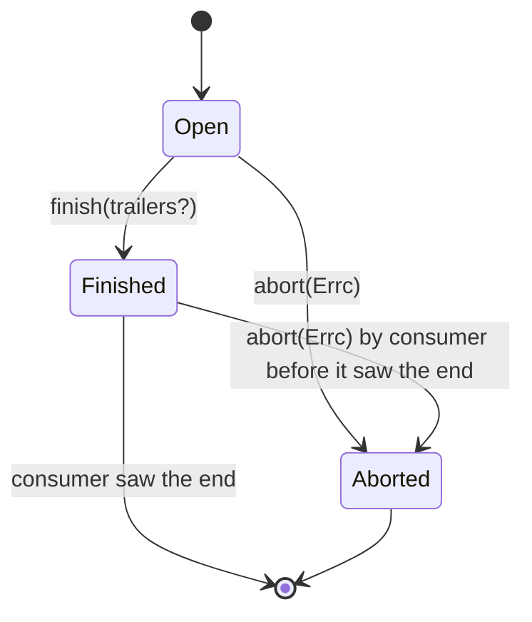
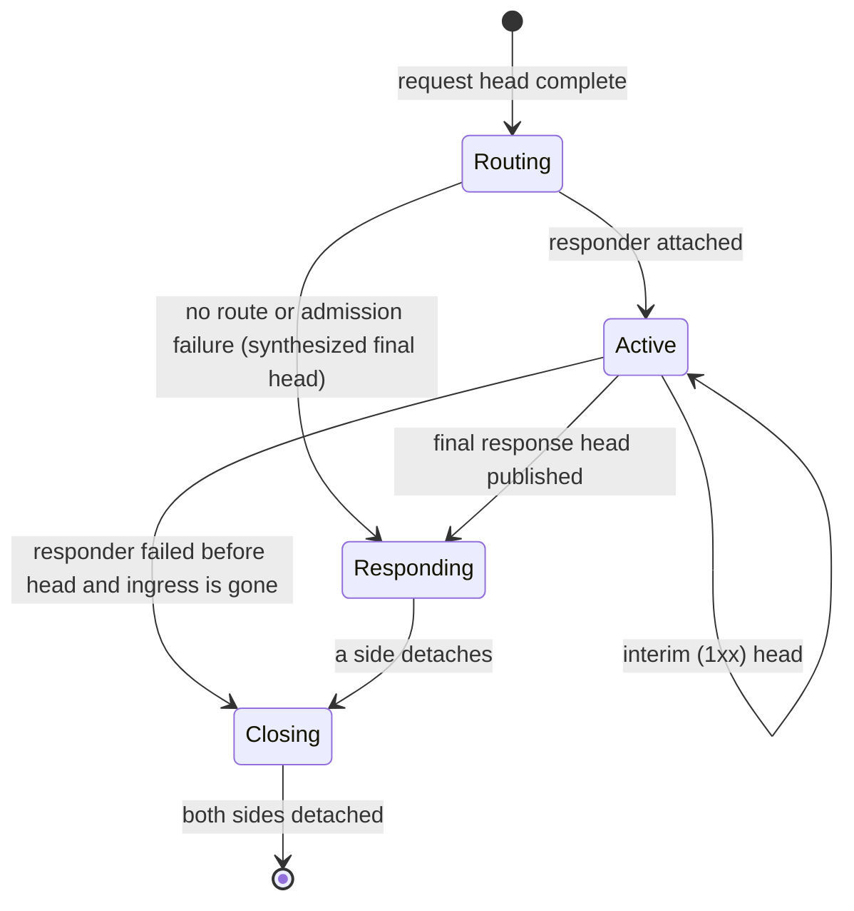

## Quick Reference (TL;DR)

- Status: `BodyStream` implemented (`include/coring5/http/BodyStream.hpp`); `Exchange`, trailers, ready list not yet.
- `Exchange` = one request/response pair on one worker; pooled slot addressed by `Handle` (I4).
- Sides: Ingress (client-facing; produces request, consumes response) and Responder (egress session, `Respond`/`Redirect`, `FileReader`).
- Streams: `ReqStream` I->R, `ResStream` R->I; each has exactly one producer and one consumer.
- `BodyStream` state: `queued`, `claimed`, `want`, `Open|Finished|Aborted(Errc)`, `declared`, `pushed`, trailers flag.
- Ops: `claim(n)` (clamped to H; Granted/Blocked), `push`, `finish(trailers?)`, `abort(e)`, `front/consume`, `wait_readable`.
- Wake rule: Writable when Open && queued <= L && H-queued-claimed >= want. Events: `kReadable|kWritable` via `take_events()`.
- Invariant: queued + claimed <= H for all protocols; Q > H is a liveness bug (clamp).
- Rules: wake on consume; wake on abort/finish both ways; abort drops credit; finish returns claim; detach cancels.
- Push on chunk-pool exhaustion -> abort `Overloaded` (shed). Byte queue = `mem/ChunkQueue`.
- Exchange phases: Routing -> Active -> Responding -> Closing -> freed (E1..E11 in section 4.2).
- Coupling: R1 head gate (no body before final head); R2 early response; R3 detach aborts open produced / unseen consumed streams; R4 free only when both sides detached; R5 terminal ops are no-ops.
- Events are level hints (bitset + one ready-list entry per Exchange); set state BEFORE raising event; handlers re-read state.
- Stale peer handles are skipped silently (not `stale_events`). `Worker::run` must not block when ready list non-empty.
- Trailers: only after last data byte; forbidden for HEAD/204/304/1xx. Model: `tools/exchange_model.py`.
- Sections: 3 BodyStream, 4 Exchange FSM, 5 Trailers, 6 pool/ownership, 7 model, 8 tests, 9 open questions.

# Exchange, BodyStream and trailers — M4.1 design specification

**Status: DESIGN, partly implemented.** `BodyStream` (section 3) is implemented
in `include/coring5/http/BodyStream.hpp` with unit tests; the `Exchange` state
machine (section 4), trailer validation (section 5) and everything else here is
not. This is the normative specification the `http` module (ADR 0010 §7) is
being written against, the first deliverable of M4.1. It refines ADR 0010 §3 (which stays
`PROPOSED`) and changes none of ADR 0003/0005/0006/0009.

Evidence labels used below:

* **[model]** — checked by the exhaustive model `tools/exchange_model.py`
  (section 7). The model is abstract; its limits are listed there.
* **[RFC]** — checked against the text of RFC 9110 (fetched while writing).
* **[code]** — checked against this repository.
* **[assumed]** — design reasoning or outside knowledge; the first
  implementation must validate it.

## 1. Scope

In: the `Exchange` state machine; the two bounded `BodyStream`s with
watermarks, credit and wake rules; trailer carriage and validation; events and
wiring between sides; deadlines; what is tested.

Out (unchanged from ADR 0010 §10): any H1/H2/H3 framing, TLS, static files,
tunnels (CONNECT/Upgrade), pipelining, the `Exchange` pool config key, head
storage layout, `ChunkPool` partitioning. Where this document needs one of
those it states the assumption and marks it open (section 9).

## 2. Vocabulary

| Term | Meaning |
|---|---|
| **Exchange** | One request/response pair on one worker. A slot in a fixed-capacity pool; addressed by `Handle` (I4). |
| **Ingress side (I)** | The session that faces the client. Produces the request, consumes the response. |
| **Responder side (R)** | Whatever produces the response: an egress session (upstream), a `Respond`/`Redirect` handler, or a `FileReader`. Consumes the request. |
| **ReqStream / ResStream** | The two `BodyStream`s: I→R and R→I. |
| **Producer / consumer** | The side that appends to / drains a stream. Exactly one of each per stream. |
| **H, L** | High / low watermark in bytes (`limits.queue_high_watermark`, `queue_low_watermark`). |
| **Q** | Largest single claim a producer makes (H1: `buffer_size`; H2/H3: window-update granularity). |
| **Credit** | `H - queued - claimed`: how many more bytes the producer may start receiving. |

## 3. BodyStream

### 3.1 State

```
queued    bytes in the queue (ChunkQueue over ChunkPool)
claimed   credit handed to the producer and not yet used or returned
want      size of the claim the producer is blocked on (0 = not blocked)
state     Open | Finished | Aborted(Errc)
declared  optional declared total length
pushed    bytes accepted so far
trailers  optional, set only by finish()
```



`Aborted` and `Finished` are terminal for the producer; `Aborted` discards the
queue and all credit immediately. The consumer **sees the end** when the state
is `Aborted`, or `Finished` with `queued == 0`.

### 3.2 Operations (the contract, not code)

| Operation | Caller | Effect |
|---|---|---|
| `claim(n)` | producer | `n` is clamped to `min(n, H)`. If `credit >= n`: `claimed += n`, returns `Granted`. Else: records `want = n`, returns `Blocked`. A producer has at most one claim or one wait outstanding (asserted). |
| `push(bytes)` | producer | Requires `bytes <= claimed`. `claimed -= granted_claim` (the whole claim is settled), `queued += bytes`. Short reads return the unused part automatically. Fails (all-or-nothing) with `Exhausted` if the chunk pool cannot supply chunks; the producer must then `abort(Overloaded)`. Wakes a waiting consumer. Exceeding `declared` aborts with `ProtocolViolation`. |
| `finish(trailers?)` | producer | State `Open -> Finished`. **Returns any outstanding claim** (see 3.4, rule 4). If `declared` is set and `pushed != declared`: abort `ProtocolViolation` instead. Wakes a waiting consumer. |
| `abort(e)` | either | State `-> Aborted(e)` (idempotent). Drops queue and credit, wakes whoever is blocked or waiting (rule 3). |
| `front()` / `consume(n)` | consumer | Same borrow rules as `ChunkQueue`. `consume` may satisfy the producer's `want` (rule 1). |
| `wait_readable()` | consumer | If the stream is empty and `Open`, registers interest; the next `push`/`finish`/`abort` raises `Readable`. |

`end_seen()`, `trailers()` and `aborted_with()` are consumer queries.
`trailers()` is valid only when the end is seen and the stream is `Finished`,
so trailers can never be observed before the last data byte (ordering by
construction).

### 3.3 Wake rule (the one that matters)

```
Writable(producer) fires when   state == Open
                          and   queued <= L
                          and   H - queued - claimed >= want        (want > 0)
```

evaluated after every `consume`, and `abort`/`finish` clear `want`. Consequences
that the model made explicit **[model]**:

* The effective resume level is `min(L, H - want)`, so `H - L < Q` is **not** a
  liveness problem, only a latency/efficiency one (the producer resumes later
  than `L`).
* `Q > H` **is** a liveness problem: a claim larger than `H` can never be
  granted. Hence the clamp `min(n, H)` in `claim`. For H1, where the kernel may
  return up to `buffer_size` bytes per recv regardless of what we asked, the
  validator must also reject `queue_high_watermark < buffer_size` (so the
  clamp never has to under-claim); this is a new config rule for the
  implementation, not made here.

### 3.4 Rules the implementation must keep (each is justified by a model run)

1. **Wake on consume.** A `consume` that makes the producer's `want`
   satisfiable raises `Writable`. Without it the exchange can deadlock
   (mutation `no wake on consume`: stuck states).
2. **Wake on abort/finish in both directions.** `abort` raises `Writable` for a
   blocked producer and `Readable` for a waiting consumer (mutation
   `abort does not wake`: consumer parked on a dead stream).
3. **Abort drops credit.** `claimed` returns to 0 at abort (mutation
   `abort keeps credit`: credit left at free).
4. **Finish returns the claim.** A read that was granted credit and returns EOF
   / END_STREAM(0 bytes) must give the claim back (mutation
   `finish keeps credit`). A producer that is *blocked* on credit has not read
   yet, so it cannot learn of EOF; the model does not allow it and the
   implementation must not either.
5. **Detach cancels.** See 4.3, rule R3 (mutation `detach does not cancel`).
6. **Not required:** waking the producer on a *release* of an unused claim. With
   one producer per stream a blocked producer holds no claim, so a release can
   never be what unblocks it (model: clean without it). Do not add the call
   "to be safe"; it hides bugs.

### 3.5 Bounds and memory

* `queued + claimed <= H` at all times, for every protocol **[model]**. This
  is stronger than ADR 0010 §3.4's first draft (which let H1 exceed `H` by one
  receive): H1 claims `Q` *before* arming the single-shot recv, so it is
  bounded like H2/H3. (L4 is unaffected: it has its own queue and keeps
  "high watermark + one recv".)
* Chunks per stream: `<= ceil(H / chunk_size) + 1` (the `+1` is a partially
  consumed head chunk). Per Exchange: two streams plus head/trailer blocks
  (layout deferred). Total is bounded by the Exchange pool size times that,
  and ultimately by the worker's `ChunkPool`.
* `push` on an exhausted pool fails and the producer aborts with `Overloaded`
  (shed, I7). Making `claim` pool-aware (so exhaustion stalls instead of
  shedding) needs a pool-level waiter list the model does not cover; **open**
  (section 9).

### 3.6 Mapping to protocols (credit is protocol-neutral)

| Protocol role | `claim` means | `push` means | `consume` triggers |
|---|---|---|---|
| H1 ingress/egress, byte stream **[assumed]** | claim `Q` before arming the single-shot recv | recv completed with `k <= Q` bytes | re-arm recv when `Writable` |
| H2/H3 receiving DATA **[assumed]** | window we are willing to advertise | DATA frame arrived; bytes beyond the granted window are a connection/stream error | `WINDOW_UPDATE` / MAX_STREAM_DATA, sent in coalesced steps (granularity deferred to M8) |
| FileReader (static) | claim `Q` before issuing a `READ` | READ completed | issue next READ |
| Respond/Redirect handler | usually one claim, one push, one finish | | |

Multishot recv is **not** used with claims in M4.1: one claim in flight per
stream keeps the accounting trivial.

### 3.7 Implementation notes (`http/BodyStream.hpp`)

Decisions the implementation made that the sections above leave open:

* **Events** are a two-bit set (`kReadable`, `kWritable`) returned by
  `take_events()`; the `Exchange` will translate them onto the ready list.
  Only a party that *registered interest* is woken: the producer by being
  `Blocked`, the consumer by `wait_readable()` returning true. A zero-length
  `push` settles the claim but wakes no reader (no data arrived).
* **Contract violations** (second claim before settling, push without or above
  the claim, `finish` while blocked) assert in debug builds; in release builds
  they abort the stream with `Errc::Internal` so the accounting cannot drift.
  Calling `claim`/`push`/`finish` after `finish` asserts and is otherwise
  refused without touching the queued data.
* **`push` on chunk-pool exhaustion** aborts the stream with
  `Errc::Overloaded` itself and returns `Exhausted` (open question 1 resolved
  as "shed", as the default of 3.5). A zero-capacity pool sheds the same way.
* **`set_declared(total)`** is part of the producer API: exceeding it in `push`
  or finishing short aborts with `Errc::ProtocolViolation`.
* **`abort` on a `Finished` stream** is a no-op once the consumer has seen the
  end, and aborts it if unread data remains (a consumer detaching early).
* **Trailers:** the stream records only *whether* `finish` carried trailers and
  hides that until the last byte was consumed (`trailers_available()`); the
  block itself, its storage and validation stay with the `Exchange` (section 5).
* The byte queue is `mem/ChunkQueue` (moved from `proto/l4`, where it was
  `RelayQueue`, so that `http` need not depend on a protocol module).
* **Not implemented:** `Exchange`, header/trailer blocks, the ready list,
  deadlines, metrics counters, any pool-aware claim.

## 4. Exchange state machine

### 4.1 Structure

An Exchange is `(phase, ReqStream, ResStream, attachment flags, pending events)`.
The streams carry their own states (3.1); `phase` tracks head negotiation and
lifetime.



The request head is complete before an Exchange exists: until then the ingress
session parses with its own bounded staging (I10), exactly as `Http1Conn` does
today **[code]**. If no Exchange slot is free the ingress answers 503 itself,
counts `conns_rejected`-style shedding, and no Exchange is created.

### 4.2 Transitions

| # | Event | Phase | Guard | Effect |
|---|---|---|---|---|
| E1 | ingress: request head complete | — | slot free | create Exchange; store head; ReqStream `Open` (declared length known) or already `Finished` when the request has no body; phase `Routing`; notify router |
| E2 | router: attach responder | Routing | | responder side attached; phase `Active` |
| E2b | router: no route / policy rejection | Routing | | a synthesized `Respond` producer publishes a final head (404/421/503...) and an empty `Finished` body; phase `Responding` |
| E3 | responder: publish interim head (1xx) | Active | ingress protocol may carry 1xx; not `101` in M4.1 (tunnel is M4.5) | event `InterimReady`. 1xx are forwarded unless we generated the expectation ourselves; never sent to an HTTP/1.0 client **[RFC]** |
| E4 | responder: publish final head | Active | head passes the response validator (5.5) | store head; event `ResponseHeadReady`; opens the ResStream gate; if the response has no content by definition (`HEAD`, 204, 304, 1xx) ResStream is created `Finished` and trailers are forbidden **[RFC]**; phase `Responding` |
| E5 | stream operations | per 3.2 | | events per 3.3/3.4 |
| E6 | responder: cancel request body | Responding | head published | `abort(Canceled)` on ReqStream. Ingress decides the wire effect (H1: finish the response, then close unless the remainder is small enough to drain; H2: `RST_STREAM(NO_ERROR)`; H3: `STOP_SENDING`). A response may complete before its request does **[RFC]**; the client "SHOULD continue sending" unless told otherwise, which is why cancel is explicit |
| E7 | responder fails before the head | Active | ingress alive | router synthesizes a head from `Errc`: `Timeout`->504, `UpstreamUnavailable`->502/503, `Overloaded`->503, else 502; empty `Finished` body; phase `Responding` |
| E8 | responder fails after the head | Responding | | `abort(e)` on ResStream. Framing cannot be repaired, so the ingress closes/resets (H1: close the connection) |
| E9 | ingress fails (client gone, timeout, protocol error, drain deadline) | any | | detach rule R3 aborts both streams |
| E10 | a side detaches | any | | rules R3/R4 |
| E11 | free | Closing | both sides detached | return all chunks of both streams (`clear`), release head/trailer storage, destroy the slot (generation bump) |

### 4.3 Coupling rules (verified in the model)

* **R1 Head gate.** The responder produces no response *body* before the final
  head is published **[model]**.
* **R2 Early response.** After the head the responder may stop reading the
  request (E6) **[model]**.
* **R3 Detach.** When a side detaches: a stream it was *producing* that is still
  `Open` is aborted; a stream it was *consuming* whose end it has not seen is
  aborted with `Canceled`. A producer that already `Finished` leaves its data
  for the consumer to drain **[model]** (this is how a fully buffered small
  response survives an ingress that closes right after reading it).
* **R4 Free.** Only when both sides are detached; at that point both streams
  hold no bytes and no credit, and each is `Aborted` or fully drained
  **[model: CLEAN]**.
* **R5 Idempotence.** Every operation on a terminal stream is a harmless no-op
  that returns the terminal state; the caller learns about abort from the
  return value or the next event, never from a crash.

### 4.4 Events and scheduling

* Events are **level hints**, not messages: `HeadReady`, `InterimReady`,
  `ResponseHeadReady`, `Readable(stream)`, `Writable(stream)`, `Aborted(stream)`.
  The Exchange holds a small bitset of pending events plus an "in ready list"
  flag. Raising an event is: set the bit; if not already listed, append the
  `Handle` to the worker's ready list. **No allocation and no overflow**: the
  list holds at most one entry per Exchange (I7).
* The worker drains the ready list after each CQE batch with a bounded budget
  (rounds and Exchanges per iteration); the rest stays for the next iteration.
  A handler **re-reads state** instead of trusting counts, so coalescing and
  late delivery are harmless. It must set the state *before* raising the event
  (the model's lost-wakeup check depends on this order).
* Delivery is a static switch on the side's `PoolId`, in the runtime module next
  to `ConnPools`; no virtual calls. A `Handle` whose generation no longer
  matches is skipped silently: stale peer links are normal here and are not
  counted in `stale_events` (I4).
* **Loop consequence [code]:** `Worker::run` currently always calls
  `submit_and_wait(1)`. With a non-empty ready list it must use a
  non-blocking submit, otherwise leftover events would sit until the next CQE
  or the 50 ms tick.
* Handlers never call into the other side directly; they only touch the shared
  Exchange and raise events (ADR 0010 §3.5, no re-entrancy).

### 4.5 Deadlines (I9)

Every wait is owned by exactly one session, by case analysis:

| Waiting party | Waits for | Deadline owner and kind |
|---|---|---|
| Producer blocked on credit | the consumer to drain | the **consumer's** session: `WriteStall` (queue non-empty, no `consume` progress) |
| Consumer waiting on an empty `Open` stream | the producer | the **producer's** session: `BodyIdle` (and `UpstreamFirstByte` before the first byte) |
| Exchange in `Routing`/`Active` without a head | the responder | ingress `HeaderRead`/`UpstreamFirstByte`; `MaxLifetime` bounds the whole Exchange |
| FileReader read in flight | the disk | the FileReader slot's `BodyIdle` |

A deadline firing aborts the stream(s) with `Timeout` through R3. The
Exchange itself has no timer, so it cannot leak a `TimerNode` (the existing
rule for intrusive nodes).

## 5. Trailers

Grounded in RFC 9110 §6.5, §7.6.1, §15.2, §15.3.5, §15.4.5 **[RFC]**.

### 5.1 Carriage

* Trailers travel only with `finish(trailers)`. They are a bounded block of
  (name, value) pairs owned by the Exchange (storage layout deferred), subject
  to the **same** `max_headers` / `max_head_bytes` limits as a head, counted
  per block. Exceeding them aborts the stream with `TooLarge`.
* Trailers **never merge into the header block** and are never interpreted by
  the proxy in M4: RFC 9110 forbids merging unless the recipient understands the
  field and its definition allows it **[RFC]**, and M4 understands none.
* Trailers are discarded with the stream on `abort`. Trailers do not count
  toward `declared` length.

### 5.2 Where trailers are forbidden

* On any message with no content: `1xx`, `204`, `304`, responses to `HEAD`, and
  `2xx` responses to `CONNECT` (tunnel) **[RFC §6.4.1, 15.2, 15.3.5, 15.4.5]**.
  Such a ResStream is created `Finished` with no trailers.
* For protocols that cannot express them: an H1 message is framed when its head
  is sent. **A length-delimited H1 response cannot carry trailers; they are
  dropped and counted, never converted.** (Converting would mean choosing
  chunked framing before the trailers are known.) Whether to force chunked when
  the upstream announced a `Trailer` header and the client sent `TE: trailers`
  is **open** (section 9).

### 5.3 Direction policy (asymmetric on purpose)

| Direction | Default | Why |
|---|---|---|
| **Response trailers** (R→I) | forwarded when the ingress can carry them (`client_accepts_trailers`) | needed for real traffic such as gRPC **[assumed]**; response trailers cannot smuggle a request |
| **Request trailers** (I→R) | **dropped and counted** unless the upstream is configured to accept them (opt-in, deferred) | the dangerous case: some backends merge trailers into headers, which turns a trailer into a smuggling vector. This is the ADR 0005 "reject, never normalise" posture applied to trailers |

`client_accepts_trailers` is set by the ingress adapter: H1: `TE` contains
`trailers` (a hop-by-hop field, so it is re-derived on every hop, never
copied) **[RFC §6.5.1, 7.6.1]**; H2/H3: true **[assumed]**. An egress adapter
sends `TE: trailers` upstream only if `client_accepts_trailers` is true,
preserving the RFC meaning "on behalf of itself and any downstream clients"
**[RFC §6.5.1]**.

### 5.4 The `Trailer` header

It is an optional *hint* **[RFC §6.6.2]**: announced fields may never arrive and
unannounced ones may. We neither require nor enforce it. It is forwarded as an
ordinary end-to-end header. Its absence never causes a rejection.

### 5.5 Validation (on entry and again on exit)

A trailer block is validated by the adapter that *receives* it and again by the
adapter that *serializes* it (same two-sided rule as heads, ADR 0010 §3.3).

1. **Syntax** (same rules as header fields): name is a `token`, lower-cased on
   entry; value contains no CR, LF or NUL **[RFC §5.5]**; `obs-text` only inside
   values; each name/value within limits. A violation aborts the stream with
   `ProtocolViolation`.
2. **Reject class** — framing, routing and hop-by-hop fields. Receiving one
   aborts the stream with `ProtocolViolation` (not a silent drop: a peer that
   sends these is attacking or broken):
   `content-length`, `transfer-encoding`, `te`, `trailer`, `connection`,
   `keep-alive`, `proxy-connection`, `upgrade`, `host`, `expect`, and any name
   listed as a `Connection` option on this message (the Connection tokens are
   applied to trailers too, RFC 9110 §7.6.1 **[RFC]**; `RequestHead` already
   collects them **[code]**). H2/H3: any pseudo-header (name starting with `:`)
   **[assumed]**.
3. **Drop class** — fields the sender "MUST NOT" put in trailers but that are
   inert when never merged. The field is removed and counted:
   `authorization`, `proxy-authorization`, `proxy-authenticate`,
   `www-authenticate`, `cache-control`, `content-encoding`, `content-type`,
   `content-range`, `range`, `max-forwards`, any `if-*`.
4. Everything else is forwarded unchanged (default-allow). A default-deny
   allow-list would break extension fields that legitimately use trailers
   (gRPC status fields **[assumed]**).

The exact membership of the two classes is **data**: a constexpr table with a
test per entry, to be reviewed against RFC 9110/9112 when implemented. The
*policy* above is what is decided here.

### 5.6 Counters (added with the implementation)

`trailers_forwarded`, `trailers_dropped` (by reason: direction policy, no
framing, class), `trailers_rejected`. They are how an operator discovers that a
backend relies on request trailers.

## 6. Exchange pool and ownership (what is decided)

* One `HandlePool<Exchange>` per worker, fixed capacity (I7); sizing key and
  head-block layout are deferred (section 9).
* Each side stores `Handle`s of the Exchange; the Exchange stores `ConnRef`
  +stream-slot references to its sides. Either side can die first.
* The Exchange issues no SQEs (ADR 0010 §3.5); in-flight operations belong to
  sessions and are counted by their `ConnCore` (I2). **The Exchange can
  therefore be freed while a session still has a recv in flight**, provided
  that session no longer reads or writes Exchange memory when the CQE arrives:
  a multiplexed session copies body bytes out (ADR 0010 §3.4 borrow rule), and
  a byte-stream session that `send`s straight from `front()` must keep its
  `consume` until the send CQE, i.e. it must stay attached until then.

## 7. The model, and what it does and does not prove

`tools/exchange_model.py` (pure Python, standard library, about 20 s) explores
every interleaving of an abstract Exchange: two bounded streams in credit
units, an ingress and a responder, the events of 3.3/4.4, and optional fault
injection (ingress dies, responder dies, responder aborts the response). It is
a design aid: it is **not** wired into CI and does not test the C++.

Checks per run: `SAFETY` (`queued + claimed <= H`), `CLEAN` (at free: no bytes,
no credit, each stream aborted or drained), `LOSTWAKE` (an attached agent
parked on an unsatisfiable wait with no wakeup in flight), `PROGRESS` (no stuck
non-freed state without faults), `REACH` (with faults, every state can still
reach free), and a coverage check that fails a run that never reached a
blocked producer or a waiting consumer.

Results of the last run (all as expected, `0 unexpected result(s)`):

| Configuration `H L Q T` | Faults | States | Outcome |
|---|---|---|---|
| 3 1 2 5, 4 1 2 6, 4 2 2 6, 2 0 2 4, 5 2 3 7 | no / yes | 11 903 to 156 079 each | clean |
| 3 2 2 5 (`H - L < Q`) | no | 24 564 | clean (efficiency only) |
| 1 0 2 4 (`Q > H`, unclamped) | no | 82 | **stuck state** (the reason for the clamp) |
| mutation: no wake on consume | no | 44 131 | stuck states |
| mutation: abort does not wake | yes | 171 448 | LOSTWAKE |
| mutation: abort keeps credit | yes | 179 077 | CLEAN violation |
| mutation: finish keeps credit | no | 48 031 | CLEAN violation |
| mutation: detach does not cancel | yes | 462 765 | CLEAN violation |
| redundancy: no wake on release | no | 44 131 | clean (rule 6) |

Writing the model also found two bugs in *the model*, worth remembering because
the same mistakes are easy in C++: a first version let a producer that was
*blocked* on credit observe EOF (which hid a real lost wakeup), and a first
`LOSTWAKE` check flagged agents that had already detached.

**It supports:** the credit protocol has no lost wakeup and conserves credit
across abort/finish/detach; memory per stream is bounded by `H`; every
mutation of a rule is detected, so the rules are necessary.

**It does not support** any claim about: byte contents or order; trailers (they
are a flag on `finish`); time (no deadlines, fairness or latency); chunk-pool
exhaustion; multiple producers or consumers per stream; event coalescing and
the scheduling budget of 4.4; tunnels; real H1/H2/H3 framing. Those need the
implementation tests below.

## 8. Test plan for the implementation (M4.1)

All in the sans-IO `http` module, no ring (so they run in the sandbox):

1. **Scenario tests** for each row of 4.2 and each rule R1–R5, plus 3.4 rules
   1–5 as regression tests named after the mutation they kill.
2. **Randomized lifecycle test**: a seeded scheduler (same idea as the
   `FakeRing` plan in TESTING §4) drives a real `Exchange` through random
   interleavings of producer/consumer/fault actions and asserts the model's
   five checks after every step. The Python model and the C++ test should
   share the action alphabet so a failing seed can be replayed in the model.
3. **Trailer table tests**: one test per reject/drop entry, plus syntax,
   limits, Connection-token stripping, "forbidden on HEAD/204/304/1xx",
   request-trailer drop by default, H1 length-delimited drop.
4. **Fuzz target** `fuzz_trailers`: arbitrary name/value sequences through the
   validator never crash and the verdict is independent of how the block is
   split (differential, like `fuzz_http1_head`).
5. Layering: the `http` module has no `io` dependency; `check_layering.py`
   must stay at 0 violations, `-Werror` on.

## 9. Open questions (deliberately not decided here)

| # | Question | Decide in |
|---|---|---|
| 1 | `ChunkPool` exhaustion: shed at `push` (default here) versus pool-aware `claim` with a pool waiter list; per-class reservations | M4.2 (with the pool partition) |
| 2 | H2->H1 response with announced trailers and `TE: trailers`: switch to chunked at head time? | M4.2 / M8 |
| 3 | Opt-in config for forwarding request trailers upstream (name, per-upstream or per-route) | M4.2 |
| 4 | Exchange pool capacity key, head/trailer storage layout (chunk chain vs arena) | start of M4.1 implementation |
| 5 | `100-continue`: a pure proxy forwards `Expect` and relays the upstream's `100`; what `Respond`/`Redirect` handlers do when no body is wanted | M4.1/M4.2 |
| 6 | H1 ingress pipelining (assumed none) | M4.1 |
| 7 | Window-update coalescing granularity for H2/H3 | M8 |
| 8 | A producer API that reads straight into a chunk (`adopt`) to save the copy for `FileReader` | M4.4 |
| 9 | Tunnel mode (CONNECT/Upgrade): reserved phase only | M4.5 |

## 10. What would show this design is wrong

* The first H2 ingress needs a change to `claim/push/consume/finish/abort`, to
  the event set, or to H1 code (the ADR 0010 falsifier).
* The randomized C++ test finds an interleaving the model accepted: then the
  model is too abstract; fix the model first, then the spec.
* Real gRPC or chunked-trailer traffic needs something the drop/reject classes
  forbid: the classes are data and may change, the *direction asymmetry* of 5.3
  may not without a new security review.
