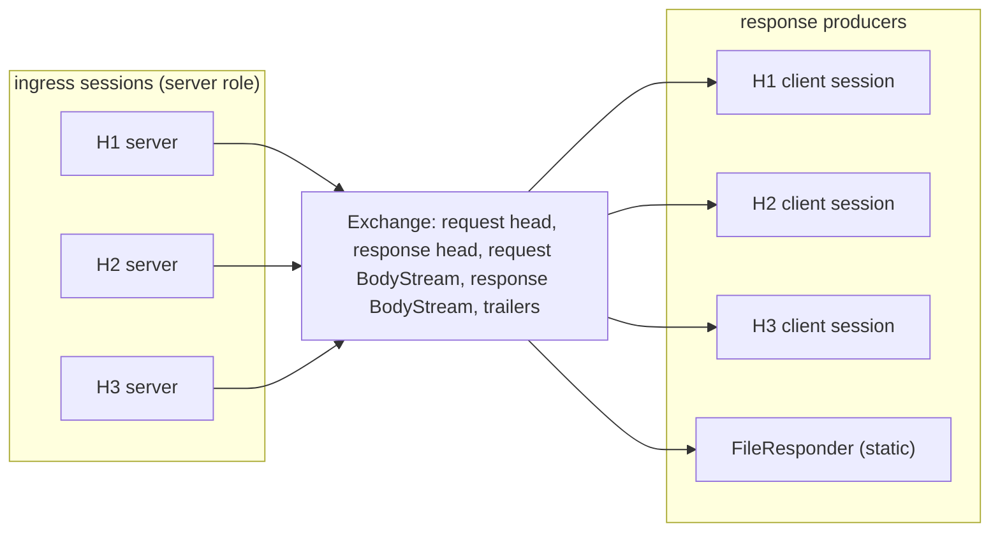

# ADR 0010 — M4 architecture: protocol-neutral Exchange layer, session lifecycles, sans-IO TLS transport, static files

**Status: Accepted (2026-11-23).** This decision records the implemented M4
HTTP/1 design and the boundaries for later protocol adapters. The M4 choices
below govern where the earlier [Exchange specification](../EXCHANGE.md)
describes a different draft. TLS, HTTP/2, and HTTP/3 remain future milestones.
This ADR builds on the existing in-flight accounting, sans-IO, buffer-lease,
and L4 relay decisions.

## 1. Context

M3 delivered an opaque TCP relay (ADR 0009). M4 and later milestones must
proxy *messages*: HTTP/1.1 first, then HTTP/2 (M8) and HTTP/3 (M10), with TLS
(M5) on either side, and also answer requests from disk (static files). The
requirements that make this hard:

* Any ingress protocol may meet any egress protocol (H3 in / H2 out, H1 in /
  H3 out). Writing one translator per pair is N x M code and N x M bugs, in the
  area where translation bugs are security bugs (request smuggling).
* Upstream connections have *different lifetimes per protocol*: a request-scoped
  byte pipe (L4), a connection reused across requests (H1 keep-alive), a
  session multiplexing many requests (H2), or a UDP flow keyed by connection ID
  (H3). One "Connection" abstraction would be wrong for at least two of them.
* TLS must work for server termination and client re-encryption without the
  protocol code knowing, and without OpenSSL ever touching a socket.
* Static files are *not* an upstream, but they must obey the same backpressure,
  deadline and shutdown rules as one.

Constraints inherited from earlier ADRs and kept: no virtual dispatch on the
data path (static dispatch through `ConnPools`), counted in-flight ops (I2),
close only at `inflight == 0` (I3), generation handles between connections
(I4), bounded queues (I6), no data-path allocation (I7), deadlines on every
wait (I9), no parked buffers (I10), downward-only layering (ADR 0007).

## 2. Decision summary

| # | Decision |
|---|---|
| D1 | Add a **protocol-neutral `Exchange`**: one request/response pair = head blocks + two bounded `BodyStream`s (+ trailers). Ingress sessions *produce* requests and *consume* responses; egress sessions and the file reader do the opposite. N ingress + M egress adapters, no N x M. |
| D2 | **`L4Conn` stays outside** the Exchange layer. It shares only primitives (`ChunkPool`, byte queue, `UpstreamPool`, `UpstreamDialer`). |
| D3 | **Lifecycle per kind, no generic Connection interface.** L4: one slot, socket pair. H1 egress: per-worker idle cache of connections. H2/H3 egress: pooled multiplexed sessions with per-stream generation handles. H3 is UDP/QUIC: it reuses `UpstreamPool` (policy) but not `UpstreamDialer` (mechanism). |
| D4 | **TLS = sans-IO `TlsSession` (module `tls`) driven by a `Transport` (module `transport`)**; one implementation for server and client role. QUIC shares only the TLS *context* (certs, SNI), not `Transport`. |
| D5 | **Static files produce an Exchange response.** The HTTP/1 connection owns its `FileResponder` and counts `OPENAT2`, `STATX`, and `READ` using its existing peer-fd accounting. |
| D6 | **`http`** holds sans-IO Exchange and handler logic. The future **`transport`** module will drive TLS. CMake and the layering check enforce the dependency direction. |

## 3. The neutral Exchange layer (D1, D2)

### 3.1 Shape



Each session type implements the Exchange API once. Adding H2 ingress touches
H2 code and registers a pool; it does not touch H1, H3, handlers or the
Exchange API. **That is the testable form of the "no N x M" claim** (see 9).

### 3.2 What the neutral layer carries, and what it must not

Carried: method, target/authority/scheme, header fields, status, informational
(1xx) responses, a body as ordered bytes with an optional declared length,
optional trailers, end-of-message, abort (with `Errc`), and a *tunnel* mode
(CONNECT / Upgrade) in which both streams become unframed bytes.

Not carried: anything that is framing of one protocol — chunk sizes, H2
`DATA`/`WINDOW_UPDATE`/`PRIORITY` frames, QUIC stream IDs, HPACK/QPACK state,
`Transfer-Encoding`, `Connection`, `Keep-Alive`, `Upgrade` negotiation
headers. Sessions strip these on the way in and synthesize them on the way out.

| Neutral concept | HTTP/1.1 | HTTP/2 | HTTP/3 |
|---|---|---|---|
| Head | request line + fields | HEADERS (+CONTINUATION), pseudo-headers | HEADERS (QPACK), pseudo-headers |
| Body framing | `Content-Length` / chunked | DATA frames, END_STREAM | DATA frames, FIN |
| Backpressure (producer side) | stop re-arming `recv` | stop returning window credit | stop reading the stream / not extending flow control |
| Trailers | chunked trailer section | trailing HEADERS | trailing HEADERS |
| Abort | close the connection (or `Connection: close`) | RST_STREAM | RESET_STREAM / STOP_SENDING |
| Tunnel | WebSocket after 101 | CONNECT stream (future) | CONNECT stream (future) |
| Early response | server answers before request body ends | allowed | allowed |

This table is the design's evidence, not a proof. **[assumed]** It has been
checked against the H1 parser that exists, not against nghttp2/nghttp3, which
are not in the tree.

### 3.3 Header block and translation safety

* The Exchange stores request and response metadata. The HTTP/1 session
  parses the head in its receive or staging buffer and gives the router a
  request view for that call. A responder that needs the request later
  serializes or copies the fields into bounded storage before suspending.
* Response fields and trailers borrow bounded responder storage. That storage
  remains live through downstream serialization or ingress detach. The
  Exchange carries field views and two bounded byte streams.
* The receiver validates its own wire syntax. The serializer validates the
  outgoing fields and generates hop-by-hop fields and framing. An HTTP/1.1
  client with `Connection: TE` and `TE: trailers` can receive permitted
  trailers from a chunked origin response. Request trailers are validated and
  dropped. Trailer fields stay separate from the head and become visible
  after the last body byte.
* Exchange has one informational status slot. A newer status replaces the
  pending one and a final head clears it. HTTP/1 emits only 100 Continue.
  An early final response completes the response and then closes the HTTP/1
  connection when the request body is incomplete.
* A pre-head responder shutdown maps to 503. A post-head failure aborts the
  body and the HTTP/1 connection closes.

### 3.4 BodyStream and backpressure (I6)

One stream = one direction, one producer, one consumer, bounded.

```
push(pool, bytes) -> bool         all-or-nothing copy into pool chunks
finish(optional trailers)        no more data after this
abort(Errc)                      terminal, wakes both sides
front()/consume(n)               consumer reads from the head
bytes(), declared_length?        a mismatch with declared length => abort(ProtocolViolation)
events: Readable (consumer), Writable (producer; fires once bytes <= low watermark)
```

The queue is the chunk-list design of M3, now `mem/ChunkQueue` over
`mem/ChunkPool` (moved down from `proto/l4` when `BodyStream` became its second
user, because `http` may not depend on `proto/l4`). L4 keeps using it directly.

Bound: **no protocol exceeds the high watermark**. A producer must `claim`
credit (`high - queued - claimed`) *before* it asks the transport for bytes: H1
claims `Q` before arming the single-shot recv, H2/H3 grant window only against
available credit, and credit is returned when the consumer drains. So a slow
reader bounds memory by construction for every protocol, which is the M3
acceptance property carried to M4. (An earlier draft of this section let H1
exceed the watermark by one receive; the exhaustive model in EXCHANGE.md §7
shows the claim-first rule is both safe and live, so the exception is dropped.
L4 keeps its own queue and its own "high watermark + one recv" bound.) The
precise claim/push/consume/finish/abort contract and its wake rules are in
[EXCHANGE.md](../EXCHANGE.md) §3.

**Borrow rule.** HTTP/1 copies bytes from the stream's `front()` into a
session-owned send buffer and consumes the acknowledged bytes on the CQE.
The backing send buffer survives in-flight I/O even when the Exchange
aborts the stream and releases its chunks.

### 3.5 Ownership, wiring, events

* Each worker sizes its Exchange pool to its startup HTTP/1 connection
  capacity. Each HTTP/1 connection has at most one active Exchange. Capacity
  exhaustion returns 503. Pipelined requests execute serially.
* An Exchange holds generation-checked peer references. Either side can be
  force-detached idempotently. Missing ingress delivery triggers detach and
  another reap check. The pool reaps only after both sides detach.
* The Exchange issues zero SQEs. Session `ConnCore` instances count the
  I/O and keep operation buffers and fds alive through completion.
* State changes raise level hints on a bounded ready list. The worker drains
  it after each CQE batch and uses nonblocking submission while ready work
  remains. Delivery checks generations and uses static dispatch.
* The HTTP/1 ingress adapter selects a route using the accepting listener ID
  and the current snapshot. Local handlers, files, and upstream HTTP all
  produce responses through Exchange credit and cancellation.
* After a matching upstream HTTP/1.1 101 for a bodyless WebSocket GET, the
  Exchange opens the request stream for tunnel bytes and uses the response
  stream for unframed downstream bytes. The adapters regenerate the two
  upgrade headers and continue enforcing stream credit, I/O deadlines, and
  teardown accounting.

### 3.6 Why `L4Conn` stays outside (D2)

L4 has no head, no framing, no message boundary, no per-request routing (the
listener names the upstream) and no stream multiplexing. Putting it behind
Exchange would add a pooled slot, two stream objects and an event hop per
connection to carry bytes it never interprets, and would tie "TLS passthrough"
(opaque by definition) to an HTTP-shaped layer. L4 shares **primitives only**:
`ChunkPool`, the byte queue, `UpstreamPool`, `UpstreamDialer`. HTTP tunnels
(Upgrade/CONNECT) are *Exchange tunnel mode*, not `L4Conn`.

Open for later (not decided): terminating TLS in front of `L4Conn` by giving it
a `Transport` on its client side. That needs no Exchange.

## 4. Lifecycles and ownership (D3)

| Kind | Owner | Lives as long as | Referenced by | Status |
|---|---|---|---|---|
| L4 relay | one pool slot, `ConnCore` + peer fd | the TCP pair | nothing else | done (ADR 0009) |
| H1 ingress | pool slot (accepted fd) | the client connection; one Exchange at a time | Exchange (by Handle) | M4 |
| H1 egress | Active HTTP/1 responder or per-worker idle fd cache | many requests (keep-alive) | active Exchange | M4 |
| H2 egress | pooled **session** slot per (backend, protocol) | many streams | Exchange via `StreamRef` | M8 |
| H3 egress | pooled **session** slot, **no per-connection fd** | many streams | Exchange via `StreamRef` | M10 |
| Static file | HTTP/1 `FileResponder` | one response | active Exchange | M4 |

### 4.1 H1 egress: per-worker keep-alive idle pool

* Each worker can park up to 64 sockets and four per backend epoch. A
  socket is eligible after a complete upload and a persistent, self-delimited
  response with no remaining wire bytes or in-flight peer operations. The
  idle lifetime uses `limits.keepalive_timeout_ms`. Expiration, upstream epoch
  changes, and drain close idle sockets. At capacity the new socket closes.
* On checkout, the worker first selects a backend with the normal balancing
  policy. It probes that backend's cached socket using
  `recv(MSG_PEEK | MSG_DONTWAIT)`. EOF, unexpected bytes, and other results
  evict it. If checkout finds no usable socket, dial the selected backend.
* `BackendLease` is released when parked and reacquired at checkout.
  Least-connections measures active exchanges.
* A peer can close immediately after the probe. The deterministic FakeRing
  regression covers that race and a later short send. One retry is available
  to idempotent methods for transient failure before any upstream byte was
  acknowledged. Once a write succeeds, the original request is never replayed.

### 4.2 H2/H3 egress: multiplexed sessions and generation handles (I4)

* A session is one pool slot (its `ConnCore` owns the TCP fd for H2; H3 owns
  none, see 4.3). Streams are *not* pool slots; they are entries of a fixed
  per-session array, each with its own generation, so
  `StreamRef{session ConnRef, slot, gen}` detects a stream that was reset and
  reused while an Exchange still points at it. A stale `StreamRef` is normal
  here and must be handled, not counted as a bug.
* Capacity is bounded by the peer's `MAX_CONCURRENT_STREAMS` capped by a limit;
  when saturated the router opens another session (bounded per backend) or
  sheds. Session death delivers `Aborted` to every attached Exchange.
* GOAWAY: no new streams; streams above `last_stream_id` were not processed and
  are safe to retry elsewhere (an explicit H2/H3 guarantee), the rest finish
  (the session's `on_drain`).
* The upstream protocol is **declared per upstream in config** (`h1`|`h2`|`h3`);
  the pool key includes it. ALPN-driven "auto" selection is deferred.

### 4.3 Why H3/QUIC is not "TCP dialing" (D3)

| | TCP (H1/H2, L4) | QUIC (H3) |
|---|---|---|
| Endpoint | one fd per connection from `socket`+`connect` | per-worker UDP socket(s); connection = connection ID, many per socket |
| Setup op | `connect` + `LINK_TIMEOUT` (`UpstreamDialer`) | no connect SQE; handshake is packets driven by ngtcp2 |
| Deadlines | one connect budget, then per-op deadlines | ngtcp2-owned timers (loss detection, PTO, idle) at millisecond scale |
| Receive | `recv` on the connection fd | multishot `recvmsg` on the shared socket, demultiplex by CID -> handle |
| Identity | fd | CID, may migrate between 4-tuples |

Consequences: `UpstreamDialer` is TCP-only by design and H3 does not use it. H3
*does* use `UpstreamPool` (policy: pick, health, epochs) and reports health on
handshake outcome. The UDP socket is a worker-level resource like a
`ListenerSlot`, not a per-connection fd, and a CID -> `Handle` map is exactly
the "real logic" use of generations that I4 already anticipates. The 50 ms
default timer-wheel tick (`tick_ms` is bounded 1..1000) is too coarse for QUIC
timers; a finer timer path is needed in M10 and is **not** decided here. Check
in M10 that `ConnCore::close()` is fine for a connection with no fd (it
currently cancels `fd()` unconditionally when ops are in flight). **[assumed]**

### 4.4 Pool-id budget (DONE in M4.0)

`OpTag` had 3 pool bits (8 ids) with 5 used (Echo, L4, Http1, Http2, Http3).
The original budget allowed for separate upstream and file pools in addition
to ingress pools. The alternatives were:

1. **Take one bit from `kind`** (`OpKind` used 15 of 64 values; 5 bits allow
   32, enough even with Openat/Statx/Close added): `pool` becomes 4 bits
   (16 ids). The layout uses explicit shifts, so this is mechanical.
2. Share one pool per protocol for both roles (role-parameterized slot type).
   Fits in 8, but one slot size must cover both roles, which defeats "a slot is
   exactly `sizeof(T)`" (ARCHITECTURE §5).

**Chosen and implemented: option 1.** The layout is now
`gen:32 | index:20 | kind:5 | pool:4 | aux:3`. The field widths are named
constants in `io/OpTag.hpp`, and `static_assert`s tie them to `OpKind::Count_`,
`kPoolCount` and `kMaxHandleIndex`, so exceeding a field fails the build
instead of corrupting tags. This reserves the id space only: no new `PoolId`
value was added (no pool type exists for them yet), and the wire values of the
existing kinds and pools are unchanged except for their bit positions.

### 4.5 Refinement of ADR 0009's open consequence

ADR 0009 noted that `UpstreamDialer` "assumes the owner has not consumed any
client data; whether that holds for HTTP is part of the M4 decision". Decision:
the real precondition is **no byte has been delivered to the upstream**, not
"no byte consumed from the client". For HTTP the request head is already parsed
by the ingress adapter and the upstream head is already serialized in bounded
storage. Early body bytes sit in the request `BodyStream`. The retry policy in
§4.1 keeps these retries lossless and duplicate-free.

## 5. TLS: sans-IO adapter shared by ingress and egress (D4)

```
              ciphertext in                      plaintext in
 socket recv -------------> [ TlsSession ] -----------------> protocol session
 socket send <------------- [  (OpenSSL   ] <----------------- (H1/H2 bytes)
              ciphertext out   memory BIOs)    plaintext out
                 ^----------- Transport (module `transport`) ----------^
```

* **`tls/` (sans-IO, no ring):** `TlsSession` with the interface sketched in
  `tls/TlsSession.hpp`, parameterized by *role* (accept/connect state) so
  termination and re-encryption are the same code. `TlsContext`s (certificates,
  CA store, ticket keys) are built on the control thread and shared read-only;
  sessions are created per connection (I1/I5). Contexts are referenced by id
  from the snapshot (I8). Depends on `base`, `config` only, so it is unit-tested
  and fuzzed like the H1 parser (ADR 0005).
* **`transport/` (ring + TLS):** one `Transport` per connection that owns the
  ciphertext staging, drives recv -> `feed` -> `read_plaintext` and
  `write_plaintext` -> `take_ciphertext` -> send, and exposes *plaintext* to the
  session. H1/H2 sessions use `Transport` for both plain and TLS sockets and do
  not know which they have. Staging is bounded (one TLS record, 16 KiB) and
  taken from the chunk pool only while bytes are pending (I10).
* One class with a runtime plain/TLS branch is preferred over templating every
  session on its transport (code size: H1/H2 x server/client x plain/TLS). To be
  settled by measurement in M5.
* **Egress specifics** (new compared with termination): SNI for the upstream
  (config or `Host`), certificate and hostname verification, per-worker session
  resumption cache keyed by backend. All config by id, none by pointer.
* **Handshake is a wait** and needs a `DeadlineKind` (none exists yet); the CPU
  cost is watched through the loop-stall histogram before any helper thread is
  considered (existing ARCHITECTURE §3 rule).
* **QUIC is different:** TLS inside QUIC travels in CRYPTO frames handled by
  ngtcp2's crypto integration, not by `TlsSession`'s byte stream. H3 shares
  only `TlsContext` (certs, SNI selection, ticket keys). **[assumed]**
* **Out:** kTLS, 0-RTT, TLS-in-front-of-L4, SNI-based L4 routing (needs a
  ClientHello peek; fuzz target already planned in M7).

## 6. Static files as a response producer (D5)

The HTTP/1 connection owns the file responder for the active Exchange.
It counts the file-open, metadata, and read SQEs through its `ConnCore`.
Cancellation and late file-open completions follow the normal fd and
in-flight accounting rules.

* The control thread pins and publishes root directories. The responder
  decodes the request target and opens relative to the selected root with
  `RESOLVE_BENEATH | RESOLVE_NO_SYMLINKS | RESOLVE_NO_XDEV`.
  Tests cover root escape and symlink rejection.
* **Fresh metadata per request.** Reopen the path and call `STATX` on the
  same fd that serves the response. This gives the response's validators
  and range decisions metadata from the opened file and avoids retaining
  stale path-to-fd mappings across replacements.
* The sans-IO planner handles GET/HEAD, single byte ranges, weak ETags and
  Last-Modified validators. If-None-Match takes precedence over
  If-Modified-Since. HEAD and 304 complete without a body read.
* The responder claims response credit before issuing `READ` at the file
  offset. Completed bytes enter the `BodyStream`. Outstanding buffers and
  fds stay live until their CQEs. A zero-copy path remains optional and
  benchmark-gated.

## 7. Layering and build (D6)

The current dependency graph is defined in `src/coring5/CMakeLists.txt` and
`tools/check_layering.py`. The HTTP/1 connection adapter depends on the sans-IO
HTTP/1 parser and session, the Exchange, the file-root helper, and networking.
The file-root helper depends downward on HTTP and I/O primitives. The
sans-IO HTTP and HTTP/1 session libraries remain testable without a ring.
The L4 adapter depends on the relay primitives. Add matching CMake and
layering entries when introducing transport and subsequent protocol modules.

## 8. Alternatives considered

| Alternative | Why not |
|---|---|
| Bytes everywhere (translate H1<->H2 on raw bytes) | Needs the protocols' parsers anyway; ends up as pairwise translators (N x M) with no place to validate once. |
| Pairwise adapters per ingress/egress pair | N x M code and N x M smuggling surfaces. |
| Virtual `Session`/`Stream` interfaces | Breaks the "no vtables" decision; hides ownership; the pools already give static dispatch. |
| nghttp2/nghttp3 request structures as the neutral form | Couples every protocol to two third-party libraries; H1 would have to emulate them. |
| One generic `Connection` abstraction for all upstreams | H1 (reused conn), H2 (multiplexed session), H3 (UDP, CID) have different ownership; the abstraction would be the union of their problems. |
| Put `L4Conn` behind Exchange for uniformity | See 3.6: cost without benefit, and it couples opaque passthrough to HTTP shapes. |
| Direct calls between sessions (no event list) | Re-entrancy and unbounded stack depth across ingress/egress; harder to bound loop time (I9/ARCHITECTURE §4). |

## 9. Consequences

* (+) Adding a protocol is one adapter, not N or M translators; validation of
  headers/framing is in one place plus each serializer.
* (+) `http`, `tls` and the planners are sans-IO: fuzzable and testable without
  `io_uring` (this matters in the sandboxed CI where `uring` tests skip).
* (+) Static files reuse the backpressure and lifecycle rules unchanged.
* (-) One extra copy per body hop (recv -> chunk -> send) and an event hop per
  state change, bounded to one loop iteration. L4 remains the zero-extra-hop
  path for opaque traffic.
* (-) More pool types (needs 4.4) and a shared `ChunkPool`: today it is sized by
  `relay_memory_mib` and its `low()` brake is global, so an L4 slow reader and
  HTTP bodies compete. Per-class reservations or a rename are needed (deferred).
* (-) Trailers, early responses and `100-continue` make the Exchange state
  machine larger than a request/response pair suggests.

**Acceptance for new adapters.** Adding an HTTP/2 ingress adapter should
preserve HTTP/1 behavior and the Exchange and BodyStream contracts. Validate
this at M8 when the first multiplexed adapter is implemented.

## 10. Deferred decisions and non-goals

| Topic | When |
|---|---|
| Shared chunk-pool reservations, request trailer forwarding opt-in, and announcing response trailers | Follow-up |
| Generic Upgrade protocols and CONNECT | Follow-up |
| Static MIME mapping and zero-copy transfer | Follow-up |
| Transport branching, handshake deadlines, TLS resumption and helper-thread policy | M5 |
| HTTP/2 flow control, stream/header limits and upstream saturation | M8 |
| QUIC timers, GSO/GRO, CID steering, 0-RTT and H3 pooling | M10 |
| ALPN-based upstream protocol selection, active health checks, and consistent hashing | Later |

## 11. M4 delivery sequence

1. **M4.0** OpTag bit split and sans-IO Exchange primitives.
2. **M4.1** HTTP/1 ingress, body framing, serial pipelining, Respond and Redirect.
3. **M4.2** Streaming reverse proxy and backpressure.
4. **M4.3** FakeRing lifecycle checks and bounded upstream keep-alive reuse.
5. **M4.4** StaticFile, validators, ranges and path-escape tests using fresh metadata.
6. **M4.5** WebSocket negotiation and unframed Exchange streams.

M5 introduces the TLS transport. M8 and M10 validate the adapter boundary with
HTTP/2 and HTTP/3, respectively.
