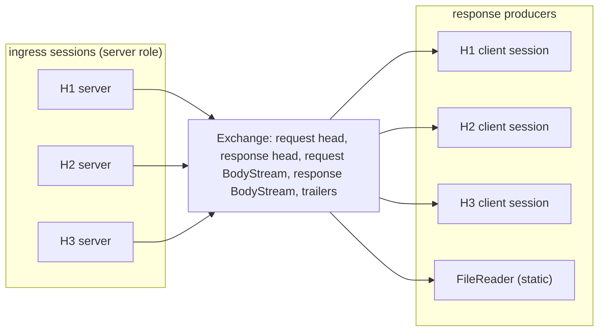
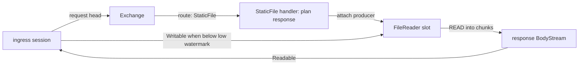
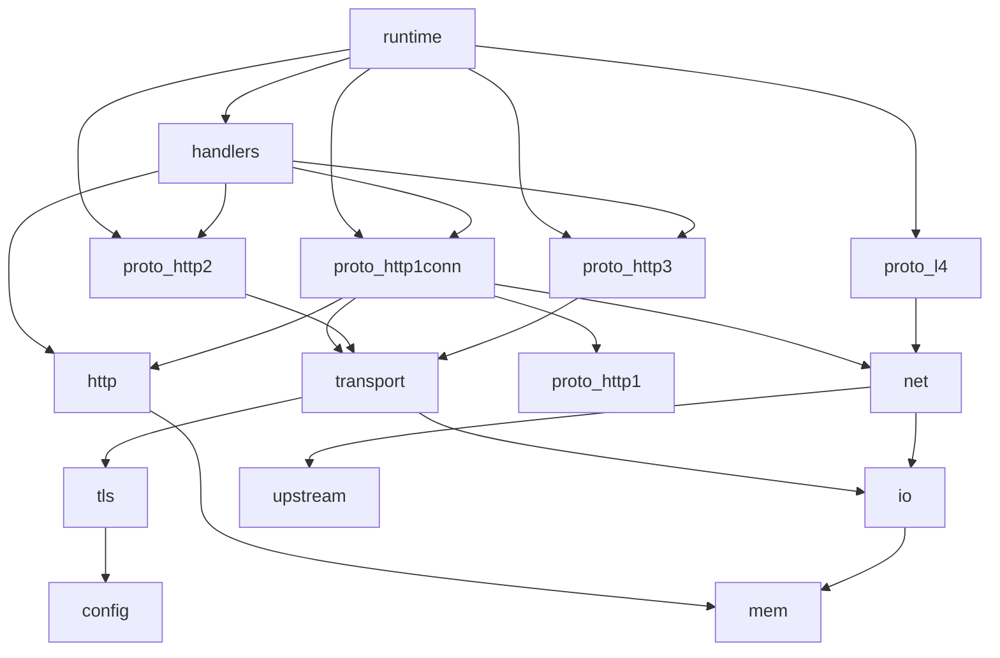

# ADR 0010 — M4 architecture: protocol-neutral Exchange layer, session lifecycles, sans-IO TLS transport, static files

**Status: PROPOSED (draft).** The only part implemented so far is the M4.0
`OpTag` bit split (§4.4); everything else is unimplemented. It decides
*shapes and boundaries* so M4 can start; every item in "Deferred" is
deliberately left open, including the H1 idle-liveness strategy (§4.1, M4.3).
The M4.1 detail of §3 (the `Exchange` state machine, `BodyStream` credit and
wake rules, trailer validation) is specified in
[EXCHANGE.md](../EXCHANGE.md), which this ADR defers to wherever they differ;
that spec is also design only. It builds on ADR 0003 (in-flight accounting), 0005
(sans-IO), 0006 (buffers/leases) and 0009 (L4 only), and does not change
them. Supersede this ADR rather than editing it once implementation starts.

Claims below are marked **[checked]** when verified in this repository while
writing the draft, and **[assumed]** when they rest on design reasoning or
outside knowledge and must be validated by the first implementation.

## 1. Context

M3 delivered an opaque TCP relay (ADR 0009). M4 and later milestones must
proxy *messages*: HTTP/1.1 first, then HTTP/2 (M8) and HTTP/3 (M10), with TLS
(M5) on either side, and also answer requests from disk (static files). The
requirements that make this hard:

* Any ingress protocol may meet any egress protocol (H3 in / H2 out, H1 in /
  H3 out). Writing one translator per pair is N x M code and N x M bugs, in the
  area where translation bugs are security bugs (request smuggling).
* Upstream connections have *different lifetimes per protocol*: a request-scoped
  byte pipe (L4), a connection reused across requests (H1 keep-alive), a
  session multiplexing many requests (H2), or a UDP flow keyed by connection ID
  (H3). One "Connection" abstraction would be wrong for at least two of them.
* TLS must work for server termination and client re-encryption without the
  protocol code knowing, and without OpenSSL ever touching a socket.
* Static files are *not* an upstream, but they must obey the same backpressure,
  deadline and shutdown rules as one.

Constraints inherited from earlier ADRs and kept: no virtual dispatch on the
data path (static dispatch through `ConnPools`), counted in-flight ops (I2),
close only at `inflight == 0` (I3), generation handles between connections
(I4), bounded queues (I6), no data-path allocation (I7), deadlines on every
wait (I9), no parked buffers (I10), downward-only layering (ADR 0007).

## 2. Decision summary

| # | Decision |
|---|---|
| D1 | Add a **protocol-neutral `Exchange`**: one request/response pair = head blocks + two bounded `BodyStream`s (+ trailers). Ingress sessions *produce* requests and *consume* responses; egress sessions and the file reader do the opposite. N ingress + M egress adapters, no N x M. |
| D2 | **`L4Conn` stays outside** the Exchange layer. It shares only primitives (`ChunkPool`, byte queue, `UpstreamPool`, `UpstreamDialer`). |
| D3 | **Lifecycle per kind, no generic Connection interface.** L4: one slot, socket pair. H1 egress: per-worker idle cache of connections. H2/H3 egress: pooled multiplexed sessions with per-stream generation handles. H3 is UDP/QUIC: it reuses `UpstreamPool` (policy) but not `UpstreamDialer` (mechanism). |
| D4 | **TLS = sans-IO `TlsSession` (module `tls`) driven by a `Transport` (module `transport`)**; one implementation for server and client role. QUIC shares only the TLS *context* (certs, SNI), not `Transport`. |
| D5 | **Static files are a body *producer* of an Exchange**, not an upstream: a `FileReader` slot using io_uring `OPENAT2`/`STATX`/`READ` (+ optional `SPLICE`), no `UpstreamPool`. |
| D6 | New modules **`http`** (sans-IO, no ring) and **`transport`** (ring + TLS); `check_layering.py` and CMake change **when those modules are created**, not now. |

## 3. The neutral Exchange layer (D1, D2)

### 3.1 Shape



Each session type implements the Exchange API once. Adding H2 ingress touches
H2 code and registers a pool; it does not touch H1, H3, handlers or the
Exchange API. **That is the testable form of the "no N x M" claim** (see 9).

### 3.2 What the neutral layer carries, and what it must not

Carried: method, target/authority/scheme, header fields, status, informational
(1xx) responses, a body as ordered bytes with an optional declared length,
optional trailers, end-of-message, abort (with `Errc`), and a *tunnel* mode
(CONNECT / Upgrade) in which both streams become unframed bytes.

Not carried: anything that is framing of one protocol — chunk sizes, H2
`DATA`/`WINDOW_UPDATE`/`PRIORITY` frames, QUIC stream IDs, HPACK/QPACK state,
`Transfer-Encoding`, `Connection`, `Keep-Alive`, `Upgrade` negotiation
headers. Sessions strip these on the way in and synthesize them on the way out.

| Neutral concept | HTTP/1.1 | HTTP/2 | HTTP/3 |
|---|---|---|---|
| Head | request line + fields | HEADERS (+CONTINUATION), pseudo-headers | HEADERS (QPACK), pseudo-headers |
| Body framing | `Content-Length` / chunked | DATA frames, END_STREAM | DATA frames, FIN |
| Backpressure (producer side) | stop re-arming `recv` | stop returning window credit | stop reading the stream / not extending flow control |
| Trailers | chunked trailer section | trailing HEADERS | trailing HEADERS |
| Abort | close the connection (or `Connection: close`) | RST_STREAM | RESET_STREAM / STOP_SENDING |
| Tunnel | after 101 / 2xx to CONNECT | CONNECT stream | CONNECT stream |
| Early response | server answers before request body ends | allowed | allowed |

This table is the design's evidence, not a proof. **[assumed]** It has been
checked against the H1 parser that exists, not against nghttp2/nghttp3, which
are not in the tree.

### 3.3 Header block and translation safety

* A neutral `HeaderBlock` is a *bounded* list (`limits.max_headers`,
  `limits.max_head_bytes`) whose bytes live in Exchange-owned storage, **not**
  as `string_view`s into an ingress buffer: H2/H3 decode into their own
  storage, and the H1 head is copied out of the receive buffer (I10).
* Canonical form is the **strictest common subset**: lower-case names, no
  CR/LF/NUL in values, no hop-by-hop fields, one `Host`/authority, a single
  framing decision. The H1 parser's *reject, never normalise* policy
  (ADR 0005) is the baseline.
* **Validate on entry and again on exit.** Header values legal in H2/H3 can be
  illegal and dangerous in H1 (CR/LF injection; `Content-Length`/`Transfer-
  Encoding` desync when an H2 request is rewritten to H1). Each egress
  serializer rejects what its protocol cannot represent instead of escaping it.
  This is the main reason the translation lives in one layer.

### 3.4 BodyStream and backpressure (I6)

One stream = one direction, one producer, one consumer, bounded.

```
push(pool, bytes) -> bool         all-or-nothing copy into pool chunks
finish(optional trailers)        no more data after this
abort(Errc)                      terminal, wakes both sides
front()/consume(n)               consumer reads from the head
bytes(), declared_length?        a mismatch with declared length => abort(ProtocolViolation)
events: Readable (consumer), Writable (producer; fires once bytes <= low watermark)
```

The queue is the chunk-list design of M3, now `mem/ChunkQueue` over
`mem/ChunkPool` (moved down from `proto/l4` when `BodyStream` became its second
user, because `http` may not depend on `proto/l4`). L4 keeps using it directly.

Bound: **no protocol exceeds the high watermark**. A producer must `claim`
credit (`high - queued - claimed`) *before* it asks the transport for bytes: H1
claims `Q` before arming the single-shot recv, H2/H3 grant window only against
available credit, and credit is returned when the consumer drains. So a slow
reader bounds memory by construction for every protocol, which is the M3
acceptance property carried to M4. (An earlier draft of this section let H1
exceed the watermark by one receive; the exhaustive model in EXCHANGE.md §7
shows the claim-first rule is both safe and live, so the exception is dropped.
L4 keeps its own queue and its own "high watermark + one recv" bound.) The
precise claim/push/consume/finish/abort contract and its wake rules are in
[EXCHANGE.md](../EXCHANGE.md) §3.

**Borrow rule.** A byte-stream session (H1, as in L4) may `send` straight from
`front()` and call `consume()` only after the send CQE. A multiplexed session
(H2/H3) must *copy* body bytes into its own output buffer or frames when it
reads them, so no body chunk is borrowed across a CQE that another stream's
death could outlive. (This keeps an Exchange freeable without waiting for any
session's in-flight ops.) **[assumed]** nghttp2/nghttp3 data providers copy;
confirm when M8 starts.

### 3.5 Ownership, wiring, events

* `Exchange` is a fixed-capacity slot in a per-worker `HandlePool<Exchange>`
  (I7; sized from config, e.g. a `[runtime.pools] exchanges` key — name TBD).
  Pool exhaustion sheds the request (503 / reset), never allocates.
* An Exchange refers to each side by `StreamRef{ConnRef conn; stream slot;
  stream gen}`; sides refer back by `Handle`. This is the "peer link" case
  where generation checks are real logic, not only a tripwire (I4): either
  side can die while the other still holds a reference.
* The Exchange issues **no SQEs**. All in-flight ops belong to sessions and are
  counted by their `ConnCore` (I2), so the Exchange is freed when both sides
  have detached, independent of kernel completions.
* **No re-entrant calls between sessions.** A side that changes state pushes an
  event (`HeadReady`, `Readable`, `Writable`, `TrailersReady`, `Aborted`) onto a
  per-worker ready list; the worker drains it after the CQE batch (like
  `ctx.closed` today), in a bounded number of rounds, and leaves the rest for
  the next iteration so one fast stream cannot starve the loop. Delivery is a
  static switch over pool id, in the same place that already knows every
  concrete type (`runtime`, next to `ConnPools`): no virtual calls.
* Routing (listener -> route -> handler kind) runs on `HeadReady`. Handlers
  (`Respond`, `Redirect`, `StaticFile`, `ReverseProxy`) are plain code that
  attaches a *response producer* to the Exchange; they do not own sockets.

### 3.6 Why `L4Conn` stays outside (D2)

L4 has no head, no framing, no message boundary, no per-request routing (the
listener names the upstream) and no stream multiplexing. Putting it behind
Exchange would add a pooled slot, two stream objects and an event hop per
connection to carry bytes it never interprets, and would tie "TLS passthrough"
(opaque by definition) to an HTTP-shaped layer. L4 shares **primitives only**:
`ChunkPool`, the byte queue, `UpstreamPool`, `UpstreamDialer`. HTTP tunnels
(Upgrade/CONNECT) are *Exchange tunnel mode*, not `L4Conn`.

Open for later (not decided): terminating TLS in front of `L4Conn` by giving it
a `Transport` on its client side. That needs no Exchange.

## 4. Lifecycles and ownership (D3)

| Kind | Owner | Lives as long as | Referenced by | Status |
|---|---|---|---|---|
| L4 relay | one pool slot, `ConnCore` + peer fd | the TCP pair | nothing else | done (ADR 0009) |
| H1 ingress | pool slot (accepted fd) | the client connection; one Exchange at a time | Exchange (by Handle) | M4 |
| H1 egress | **per-worker idle cache** of connection slots | many requests (keep-alive) | Exchange while checked out | M4 |
| H2 egress | pooled **session** slot per (backend, protocol) | many streams | Exchange via `StreamRef` | M8 |
| H3 egress | pooled **session** slot, **no per-connection fd** | many streams | Exchange via `StreamRef` | M10 |
| Static file | `FileReader` slot (the file fd) | one response | Exchange (by Handle) | M4 |

### 4.1 H1 egress: per-worker keep-alive idle pool

* Dial with `UpstreamDialer` (it dials *before any upstream byte is sent*, so
  its retries remain safe; see 4.5). A finished exchange with a reusable
  response parks the connection in an idle list keyed by
  `(UpstreamId, backend, epoch)`, capped per backend, with the keep-alive
  deadline from `limits.keepalive_timeout` (I9). A reload that changes the
  upstream bumps its epoch, so stale idle entries are dropped on next touch.
* **Idle-connection liveness: DECISION DEFERRED TO M4.3.** The roadmap names a
  `MSG_PEEK` probe at reuse time. That has no cheap async form on io_uring and
  a synchronous peek on the loop thread is a race of its own, so the choice is
  genuinely open. Candidates, none of them selected here:
  1. *Armed idle `recv`:* park the connection with one outstanding `recv` (no
     provided buffer is consumed until data arrives, so I10 holds). If it
     completes while idle (EOF, error, stray bytes) evict; at checkout it
     simply becomes the response read. Avoids a cancel-and-rearm step but makes
     checkout depend on an operation that may be mid-completion.
  2. *Cancel-and-rearm / probe at checkout:* park with nothing in flight and
     verify on reuse (non-blocking `recv(MSG_PEEK)` or a short-lived op).
     Simpler ownership, but pays a check on every reuse.
  3. *No liveness check:* reuse blindly and rely on the retry rule below.
     Cheapest, and may be good enough when retries are safe.

  The deciding evidence is a deterministic test of the race (a peer closing an
  idle connection while it is being checked out), which needs the `FakeRing`
  harness (TESTING §4, not yet written). M4.3 therefore starts by building that
  harness, then picks one candidate with a test that fails for the other
  designs' failure modes. Nothing in M4.0–M4.2 may depend on the choice: until
  then H1 egress is connection-per-request (no idle pool at all).
* `BackendLease` is released when parked and re-acquired at checkout, so
  least-connections counts *active* use, not idle sockets.
* The classic race (server closes an idle connection as we send): the request
  fails with no response byte. Retry only if the method is idempotent, no
  response byte arrived, and the request body is still replayable (fully held
  in the stream). Otherwise answer 502. This is the roadmap's rule, kept.

### 4.2 H2/H3 egress: multiplexed sessions and generation handles (I4)

* A session is one pool slot (its `ConnCore` owns the TCP fd for H2; H3 owns
  none, see 4.3). Streams are *not* pool slots; they are entries of a fixed
  per-session array, each with its own generation, so
  `StreamRef{session ConnRef, slot, gen}` detects a stream that was reset and
  reused while an Exchange still points at it. A stale `StreamRef` is normal
  here and must be handled, not counted as a bug.
* Capacity is bounded by the peer's `MAX_CONCURRENT_STREAMS` capped by a limit;
  when saturated the router opens another session (bounded per backend) or
  sheds. Session death delivers `Aborted` to every attached Exchange.
* GOAWAY: no new streams; streams above `last_stream_id` were not processed and
  are safe to retry elsewhere (an explicit H2/H3 guarantee), the rest finish
  (the session's `on_drain`).
* The upstream protocol is **declared per upstream in config** (`h1`|`h2`|`h3`);
  the pool key includes it. ALPN-driven "auto" selection is deferred.

### 4.3 Why H3/QUIC is not "TCP dialing" (D3)

| | TCP (H1/H2, L4) | QUIC (H3) |
|---|---|---|
| Endpoint | one fd per connection from `socket`+`connect` | per-worker UDP socket(s); connection = connection ID, many per socket |
| Setup op | `connect` + `LINK_TIMEOUT` (`UpstreamDialer`) | no connect SQE; handshake is packets driven by ngtcp2 |
| Deadlines | one connect budget, then per-op deadlines | ngtcp2-owned timers (loss detection, PTO, idle) at millisecond scale |
| Receive | `recv` on the connection fd | multishot `recvmsg` on the shared socket, demultiplex by CID -> handle |
| Identity | fd | CID, may migrate between 4-tuples |

Consequences: `UpstreamDialer` is TCP-only by design and H3 does not use it. H3
*does* use `UpstreamPool` (policy: pick, health, epochs) and reports health on
handshake outcome. The UDP socket is a worker-level resource like a
`ListenerSlot`, not a per-connection fd, and a CID -> `Handle` map is exactly
the "real logic" use of generations that I4 already anticipates. The 50 ms
default timer-wheel tick (`tick_ms` is bounded 1..1000) is too coarse for QUIC
timers; a finer timer path is needed in M10 and is **not** decided here. Check
in M10 that `ConnCore::close()` is fine for a connection with no fd (it
currently cancels `fd()` unconditionally when ops are in flight). **[assumed]**

### 4.4 Pool-id budget (DONE in M4.0)

`OpTag` had 3 pool bits (8 ids) with 5 used (Echo, L4, Http1, Http2, Http3).
This design needs at least Http1Up, Http2Up, Http3Up and FileReader: nine.
Options were:

1. **Take one bit from `kind`** (`OpKind` used 15 of 64 values; 5 bits allow
   32, enough even with Openat/Statx/Close added): `pool` becomes 4 bits
   (16 ids). The layout uses explicit shifts, so this is mechanical.
2. Share one pool per protocol for both roles (role-parameterized slot type).
   Fits in 8, but one slot size must cover both roles, which defeats "a slot is
   exactly `sizeof(T)`" (ARCHITECTURE §5).

**Chosen and implemented: option 1.** The layout is now
`gen:32 | index:20 | kind:5 | pool:4 | aux:3`. The field widths are named
constants in `io/OpTag.hpp`, and `static_assert`s tie them to `OpKind::Count_`,
`kPoolCount` and `kMaxHandleIndex`, so exceeding a field fails the build
instead of corrupting tags. This reserves the id space only: no new `PoolId`
value was added (no pool type exists for them yet), and the wire values of the
existing kinds and pools are unchanged except for their bit positions.

### 4.5 Refinement of ADR 0009's open consequence

ADR 0009 noted that `UpstreamDialer` "assumes the owner has not consumed any
client data; whether that holds for HTTP is part of the M4 decision". Decision:
the real precondition is **no byte has been delivered to the upstream**, not
"no byte consumed from the client". For HTTP the request head is already parsed
into the Exchange and any early body bytes sit in the request `BodyStream`, so
dial retries remain lossless and duplicate-free. Whether the *request* may be
retried after the head was sent is the separate policy in 4.1.

## 5. TLS: sans-IO adapter shared by ingress and egress (D4)

```
              ciphertext in                      plaintext in
 socket recv -------------> [ TlsSession ] -----------------> protocol session
 socket send <------------- [  (OpenSSL   ] <----------------- (H1/H2 bytes)
              ciphertext out   memory BIOs)    plaintext out
                 ^----------- Transport (module `transport`) ----------^
```

* **`tls/` (sans-IO, no ring):** `TlsSession` with the interface sketched in
  `tls/TlsSession.hpp`, parameterized by *role* (accept/connect state) so
  termination and re-encryption are the same code. `TlsContext`s (certificates,
  CA store, ticket keys) are built on the control thread and shared read-only;
  sessions are created per connection (I1/I5). Contexts are referenced by id
  from the snapshot (I8). Depends on `base`, `config` only, so it is unit-tested
  and fuzzed like the H1 parser (ADR 0005).
* **`transport/` (ring + TLS):** one `Transport` per connection that owns the
  ciphertext staging, drives recv -> `feed` -> `read_plaintext` and
  `write_plaintext` -> `take_ciphertext` -> send, and exposes *plaintext* to the
  session. H1/H2 sessions use `Transport` for both plain and TLS sockets and do
  not know which they have. Staging is bounded (one TLS record, 16 KiB) and
  taken from the chunk pool only while bytes are pending (I10).
* One class with a runtime plain/TLS branch is preferred over templating every
  session on its transport (code size: H1/H2 x server/client x plain/TLS). To be
  settled by measurement in M5.
* **Egress specifics** (new compared with termination): SNI for the upstream
  (config or `Host`), certificate and hostname verification, per-worker session
  resumption cache keyed by backend. All config by id, none by pointer.
* **Handshake is a wait** and needs a `DeadlineKind` (none exists yet); the CPU
  cost is watched through the loop-stall histogram before any helper thread is
  considered (existing ARCHITECTURE §3 rule).
* **QUIC is different:** TLS inside QUIC travels in CRYPTO frames handled by
  ngtcp2's crypto integration, not by `TlsSession`'s byte stream. H3 shares
  only `TlsContext` (certs, SNI selection, ticket keys). **[assumed]**
* **Out:** kTLS, 0-RTT, TLS-in-front-of-L4, SNI-based L4 routing (needs a
  ClientHello peek; fuzz target already planned in M7).

## 6. Static files as a response producer (D5)

Static serving is the *other* kind of response producer. The Exchange does not
care whether response bytes come from an upstream session or a file.



* **Not an upstream:** no `UpstreamPool`, no `UpstreamDialer`, no health, no
  `BackendLease`. Selection happens in routing, which yields a root + path.
* **`FileReader` is its own pool slot** (own `ConnCore`, fd = the file). This
  reuses I2/I3 unchanged: a `READ` on a file fd is *not* cancelled by the
  socket's `cancel_fd`, so the file needs its own fd-scoped cancel and its own
  in-flight count, and it must be able to finish or cancel independently of a
  client that aborted. The rejected alternative is generalizing `ConnCore` from
  "fd + peer" to N auxiliary fds, which changes the primitive every connection
  type depends on. It costs one more pool id (see 4.4).
* **Async metadata and open:** `OPENAT2` and `STATX` exist as io_uring ops
  **[checked]** in the installed liburing/kernel headers, so a cold-disk open
  does not block the loop and no helper thread is needed (ARCHITECTURE §3).
  `OpKind` needs `Openat`, `Statx`, `Close` added (it has `Read` and `Splice`).
* **Path safety in depth:** the request path goes through the sans-IO
  normalizer (mandatory escape tests, ROADMAP M4) *and* `openat2` relative to a
  pre-opened root dirfd with `RESOLVE_BENEATH | RESOLVE_NO_MAGICLINKS`
  (symlink policy configurable) so the kernel refuses an escape even if the
  normalizer is wrong. **[assumed]** semantics from kernel documentation
  (>= 5.6, within our 6.1 floor), not tested here. Root dirfds are created on
  the control thread and delivered to workers like listener fds (I5, I8), not
  stored in the snapshot.
* **Body path:** baseline is `READ` (with file offset) into `ChunkPool` chunks
  -> response `BodyStream` -> session. Reads are issued only while the stream is
  below its low watermark, so a slow client bounds both memory and open reads.
  Works for every ingress protocol and for TLS.
* **`SPLICE` (file -> pipe -> socket) is optional and benchmark-gated**, same
  stance as L4. It applies only when the ingress side is H1 over a *plain*
  socket with a known `Content-Length`; H2/H3 framing and TLS require the copy
  path (kTLS is out of scope).
* **Response planning is sans-IO:** `plan(request head, file metadata) ->
  {status, headers, byte range}` covering `Range`, `If-Modified-Since`,
  `If-None-Match`/ETag, `HEAD`, content type. Pure function, fuzzable, no
  ring. Metadata (fd + `statx`) is cached per worker, bounded; invalidation
  rules are deferred.

## 7. Layering and build (D6)

Proposed module graph (arrows = "may include/link", downward only). Acyclicity
of this graph **[checked]** with a throwaway script (not committed):



Rules this implies:

* **`http` has no `io` dependency** (like `config`): Exchange state machine,
  `BodyStream`, `HeaderBlock` and the static-response planner are unit-testable
  and fuzzable without a kernel ring.
* **Session modules never include `handlers`.** Ingress sessions emit events;
  the runtime-level router (next to `ConnPools`) calls handlers. Letting
  `proto/http1conn` call handlers directly makes a cycle
  (`proto/http1conn -> handlers -> proto/http1conn`) **[checked]**.
* **`proto/l4` must not depend on `http`, `transport`, `tls` or `handlers`**
  (this is how D2 is enforced mechanically).
* **Until those modules exist, `tools/check_layering.py` and CMake are
  untouched.** Each milestone adds its module and the matching `ALLOWED`/CMake
  entries in the same commit; the check must stay at 0 violations at every
  commit, and `-Werror` stays on for all new targets.

## 8. Alternatives considered

| Alternative | Why not |
|---|---|
| Bytes everywhere (translate H1<->H2 on raw bytes) | Needs the protocols' parsers anyway; ends up as pairwise translators (N x M) with no place to validate once. |
| Pairwise adapters per ingress/egress pair | N x M code and N x M smuggling surfaces. |
| Virtual `Session`/`Stream` interfaces | Breaks the "no vtables" decision; hides ownership; the pools already give static dispatch. |
| nghttp2/nghttp3 request structures as the neutral form | Couples every protocol to two third-party libraries; H1 would have to emulate them. |
| One generic `Connection` abstraction for all upstreams | H1 (reused conn), H2 (multiplexed session), H3 (UDP, CID) have different ownership; the abstraction would be the union of their problems. |
| Put `L4Conn` behind Exchange for uniformity | See 3.6: cost without benefit, and it couples opaque passthrough to HTTP shapes. |
| Direct calls between sessions (no event list) | Re-entrancy and unbounded stack depth across ingress/egress; harder to bound loop time (I9/ARCHITECTURE §4). |

## 9. Consequences

* (+) Adding a protocol is one adapter, not N or M translators; validation of
  headers/framing is in one place plus each serializer.
* (+) `http`, `tls` and the planners are sans-IO: fuzzable and testable without
  `io_uring` (this matters in the sandboxed CI where `uring` tests skip).
* (+) Static files reuse the backpressure and lifecycle rules unchanged.
* (-) One extra copy per body hop (recv -> chunk -> send) and an event hop per
  state change, bounded to one loop iteration. L4 remains the zero-extra-hop
  path for opaque traffic.
* (-) More pool types (needs 4.4) and a shared `ChunkPool`: today it is sized by
  `relay_memory_mib` and its `low()` brake is global, so an L4 slow reader and
  HTTP bodies compete. Per-class reservations or a rename are needed (deferred).
* (-) Trailers, early responses and `100-continue` make the Exchange state
  machine larger than a request/response pair suggests.

**Falsifier (how we will know this ADR is wrong):** the first H2 ingress
implementation (M8) must not require changes to the Exchange/BodyStream API or
to H1 code. If it does, or if none of the idle-liveness candidates (4.1) can be
made race-free under `FakeRing` in M4.3, supersede this ADR instead of patching
around it.

## 10. Deferred decisions and non-goals

Not decided here, to be settled in the milestone shown:

| Topic | When |
|---|---|
| Exact `Exchange` state machine, `BodyStream` credit rules, trailer rules, early response, 1xx forwarding | **specified in [EXCHANGE.md](../EXCHANGE.md) (design only); implementation M4.1** |
| Open items of EXCHANGE.md §9 (pool-aware claims, forcing chunked for announced trailers, request-trailer opt-in, `100-continue` details, window-update coalescing) | M4.1–M4.2, M8 |
| Pipelining policy for H1 ingress (initially: none) | M4.1 |
| `Exchange` pool sizing/config key and head storage layout (chunk chain vs arena) | M4.1 |
| ~~`PoolId`/`OpKind` bit split (4.4)~~ | **done in M4.0** |
| H1 egress idle-connection liveness strategy (4.1) | **M4.3**, after `FakeRing` exists |
| `ChunkPool` partitioning between L4 and HTTP; renaming `relay_memory_mib` | M4.2 |
| Idle-cache sizing (`max_idle_keepalive`), eviction order, per-backend caps | M4.3 |
| Static: metadata cache and invalidation, MIME table, symlink policy, root dirfd delivery, `SPLICE` strategy | M4.4 |
| Upgrade/WebSocket and CONNECT tunnel details | M4.5 |
| `Transport` plain/TLS branching strategy, handshake `DeadlineKind`, resumption cache, helper-thread question | M5 |
| H2 flow-control mapping, stream/header limits, rapid-reset/CONTINUATION defenses, upstream stream saturation policy | M8 |
| QUIC timers resolution, GSO/GRO, CID steering, migration, 0-RTT, upstream H3 pooling | M10 |
| Upstream `protocol = "auto"` (ALPN selection), active health checks, consistent hashing | after M8 |

Explicit non-goals of this ADR and of M4's first milestones: implementing any of
the above; changing `L4Conn`, `UpstreamDialer`, `UpstreamPool`, ADR 0009, or the
public config schema; caching, compression, WAF/rate limiting, request
buffering to disk; kTLS and TLS-in-front-of-L4.

## 11. Proposed M4 sequence (each step demoable, 0 layering violations, `-Werror`)

1. **M4.0** `PoolId`/`OpKind` bit split (**done**: `OpTag` is now
   `gen:32 | index:20 | kind:5 | pool:4 | aux:3`); then the `http` module with
   `HeaderBlock`, `BodyStream`, `Exchange` state machine and unit tests (no
   ring) — not started.
2. **M4.1** H1 ingress + body framing + `Respond`/`Redirect` handlers (no
   upstream).
3. **M4.2** H1 egress with connection-per-request via `UpstreamDialer` +
   `ReverseProxy`; first end-to-end bodies with backpressure tests.
4. **M4.3** `FakeRing` harness, then the H1 keep-alive idle cache; the idle
   liveness strategy (4.1) is chosen here, driven by a deterministic race test.
5. **M4.4** `StaticFile` + `FileReader` + path-escape corpus.
6. **M4.5** Upgrade/WebSocket tunnel mode.

Then M5 (`Transport` + TLS), M8 (H2), M10 (H3), each validating D1 by adding
one adapter.
